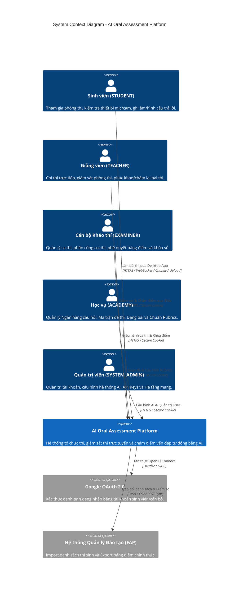
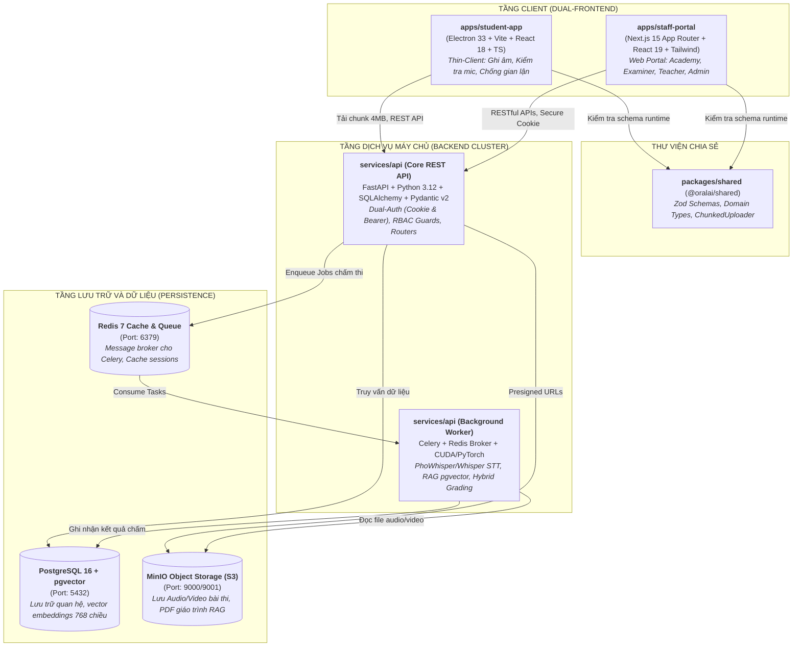
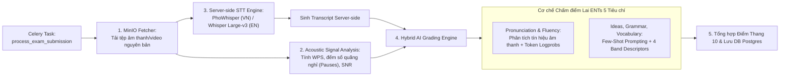
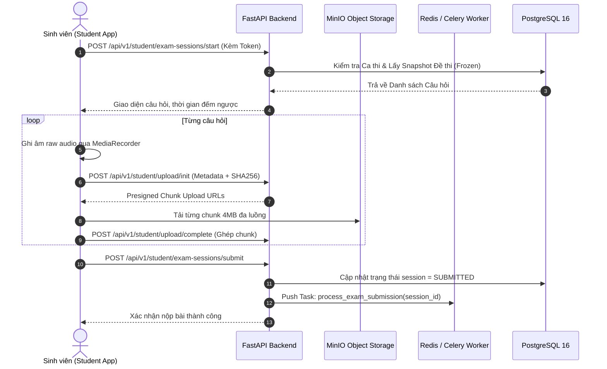

# ARCHITECTURE.md — BẢN ĐỒ KIẾN TRÚC TOÀN DIỆN (SYSTEM ARCHITECTURE)

> **Dự án:** AI Oral Assessment Platform (Hệ thống Thi vấn đáp Tự động bằng AI)
> **Chủ sở hữu:** Nguyễn Văn Gia Bình & Nhóm NCKH / Đồ án Tốt nghiệp CNTT
> **Phiên bản kiến trúc:** 3.0 (Monorepo, Dual-Frontend, Server-Side STT & Hybrid AI Grading)
> **Trạng thái:** ACTIVE & EVERGREEN (Tài liệu sống — Cập nhật cùng các thay đổi kiến trúc lớn)

---

## 1. TỔNG QUAN HỆ THỐNG & TRIẾT LÝ THIẾT KẾ (SYSTEM OVERVIEW)

**AI Oral Assessment Platform** là nền tảng thi vấn đáp tự động ứng dụng Trí tuệ Nhân tạo, giải quyết bài toán tổ chức thi, coi thi và chấm điểm nói tiếng Anh (chuẩn ENTs Speaking 5 tiêu chí) và vấn đáp chuyên ngành quy mô lớn tại các cơ sở giáo dục đại học.

### 5 Nguyên tắc Bất biến trong Kiến trúc (Architectural Invariants):

1. **Server là Source of Truth:** Không bao giờ tin tưởng Client (Desktop/Web). Mọi logic về thời gian làm bài, điều phối câu hỏi, trạng thái phòng thi, tính toán điểm số và khóa kết quả 100% do Server kiểm soát.
2. **Server-side STT & Anti-Tampering (Bảo mật chống gian lận):** Student App là **Thin-Client**. Client tuyệt đối không chạy PhoWhisper local, không tạo transcript và không cho phép chỉnh sửa văn bản câu trả lời. File âm thanh/video nguyên bản được tải lên MinIO dạng phân mảnh (chunk 4MB kèm SHA-256). Toàn bộ quá trình phiên âm và chấm điểm diễn ra trên Server Worker.
3. **Chuẩn hóa 5 Vai trò (Actor-based RBAC):** Hệ thống phân quyền nghiêm ngặt theo 5 actor: `SYSTEM_ADMIN`, `ACADEMY`, `EXAMINER`, `TEACHER`, `STUDENT`.
4. **Exam Snapshot Versioning:** Khi đề thi chuyển sang trạng thái `PUBLISHED`, toàn bộ tài liệu RAG, cấu hình câu hỏi, Rubric và AI Prompts tại thời điểm đó phải được **đóng băng (Freeze)**. Mọi bài thi sau đó đều chấm theo Snapshot bất biến này.
5. **Strangler Fig Refactoring Pattern:** Phát triển song song và độc lập giữa `@oralai/shared`, `apps/student-app`, `apps/staff-portal` với backend, không phá vỡ tính liên tục của hệ thống.

---

## 2. LEVEL 1: SƠ ĐỒ BỐI CẢNH HỆ THỐNG (SYSTEM CONTEXT DIAGRAM)

Mô hình C4 Level 1 thể hiện ranh giới hệ thống đối với người dùng (Actors) và các hệ thống bên ngoài (External Systems):



---

## 3. LEVEL 2: SƠ ĐỒ THÙNG CHỨA DỊCH VỤ (CONTAINERS DIAGRAM)

Mô hình C4 Level 2 bóc tách các phân hệ phần mềm và cơ sở hạ tầng vận hành:



---

## 4. LEVEL 3: CÁC THÀNH PHẦN CỐT LÕI (COMPONENT ARCHITECTURE)

### 4.1. Cấu trúc Core API (`services/api/app/`)

* **`main.py`:** Khởi tạo FastAPI app, middleware (CORS, Request Tracing, Dual-Auth extractor), đăng ký Routers.
* **Tầng Routers chuẩn hóa theo Actor:**
  - `routes_auth.py`: Xác thực JWT, Cookie session, Google OAuth.
  - `routes_academy.py`: Quản trị Item Bank, Exam Matrix Blueprint, Question Types, Rubrics Studio.
  - `routes_examiner.py`: Học kỳ, Ca thi, Phân bổ thí sinh, Phê duyệt điểm, Khóa sổ.
  - `routes_teacher.py`: Lịch coi thi (`/teacher/schedule`), Phòng coi thi trực tiếp (`/teacher/proctor`), Phúc khảo (`/teacher/results/override`).
  - `routes_student.py`: Nhận đề thi, Kiểm tra trạng thái làm bài, Nộp bài thi.
  - `routes_admin.py`: Quản lý tài khoản, cấu hình tham số AI Models, Network.
* **`models.py` & `models_academy.py`:** SQLAlchemy ORM models, bảng quan hệ và Snapshot entities.
* **`schemas.py` & `schemas_academy.py`:** Pydantic v2 schemas phục vụ Serialization & Validation.

### 4.2. Cấu trúc AI Background Worker Pipeline



---

## 5. LUỒNG DỮ LIỆU TIÊU BIỂU (END-TO-END DATA FLOWS)

### 5.1. Luồng Sinh viên Làm bài thi & Nộp bài Chống gian lận (Anti-Tampering Flow)



---

## 6. BẢNG ÁNH XẠ HẠ TẦNG & CỔNG MẠNG (INFRASTRUCTURE & PORT MAPPING)

| Dịch vụ Container    | Image / Công nghệ      | Cổng Host (External)              | Cổng Nội bộ     | Mục đích vận hành                              |
| :--------------------- | :----------------------- | :--------------------------------- | :----------------- | :-------------------------------------------------- |
| **`web`**      | Node 20 / Next.js 15     | `3000`                           | `3000`           | Staff Portal (Giao diện Quản trị & Giảng viên) |
| **`api`**      | Python 3.12 / FastAPI    | `8000`                           | `8000`           | Core REST API Server                                |
| **`worker`**   | Celery / PyTorch         | —                                 | —                 | Xử lý hàng đợi STT & Chấm điểm tự động   |
| **`postgres`** | PostgreSQL 16 + pgvector | `5432`                           | `5432`           | Cơ sở dữ liệu quan hệ & Vector Database        |
| **`redis`**    | Redis 7 Alpine           | `6379`                           | `6379`           | Message Broker & Caching                            |
| **`minio`**    | MinIO RELEASE            | `9000` (API), `9001` (Console) | `9000`, `9001` | S3 Object Storage (Media & PDFs)                    |

---

## 7. CẤU TRÚC THƯ MỤC NGUỒN (MONOREPO DIRECTORY MAP)

```
AI-Oral-Assessment-Platform/
├── ARCHITECTURE.md                 # Tài liệu này (Living Architecture)
├── AGENTS.md / GEMINI.md           # Quy tắc phát triển & Context Handover cho AI
├── docker-compose.yml              # Khởi tạo cụm 6 Containers chính
├── packages/
│   └── shared/                     # @oralai/shared: Domain types, Zod schemas, ChunkedUploader
├── apps/
│   ├── student-app/                # Desktop Client (Electron + Vite + React 18)
│   └── staff-portal/               # Web Portal (Next.js 15 App Router)
├── services/
│   └── api/                        # FastAPI Backend & Celery Worker
│       ├── app/                    # Mã nguồn backend (routes, models, schemas, worker)
│       └── tests/                  # Bộ Pytest kiểm thử backend
└── docs/                           # Hệ sinh thái tài liệu kỹ thuật chuẩn công nghiệp
    ├── README.md                   # Bảng mục lục điều hướng toàn diện (Map of Content)
    ├── adr/                        # Architecture Decision Records (Append-only)
    ├── api/                        # Đặc tả REST API chuẩn hóa theo Actor
    ├── specs/                      # Đặc tả thiết kế tính năng (Technical Specs/RFCs)
    ├── runbooks/                   # Hướng dẫn vận hành, kiểm thử & kịch bản demo
    ├── research/                   # Nghiên cứu khoa học, cơ sở lý thuyết, bài báo
    ├── diagrams/                   # Sơ đồ Draw.io & Activity flowcharts
    └── archive/                    # Tài liệu lịch sử, ghi chú bàn giao cũ
```
