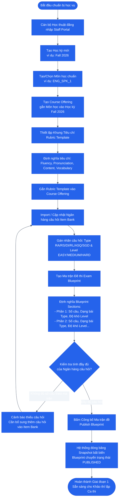

# SƠ ĐỒ HOẠT ĐỘNG: GIAI ĐOẠN 1 — CHUẨN BỊ HỌC VỤ & MA TRẬN ĐỀ
## Academic Preparation & Blueprint Publishing

### 1. Mục tiêu
Cán bộ Học thuật (`ACADEMY`) thiết lập toàn bộ nền tảng học vụ cho kỳ thi, bao gồm: Tạo học kỳ, môn học mở trong kỳ (`course_offering`), định nghĩa khung rubric chuẩn, quản lý ngân hàng câu hỏi (`item_bank`) phân loại theo dạng bài và độ khó, và đóng gói ma trận đề thi (`exam_blueprint`) bất biến.

---

### 2. Sơ đồ Hoạt động (Activity Diagram)

---

### 3. Đầu vào, Đầu ra & Thực thể dữ liệu liên quan

* **Tác tử thực hiện:** Cán bộ Học thuật (`ACADEMY`).
* **Đầu vào (Input):** Đề cương môn học, bộ tiêu chí đánh giá, danh mục câu hỏi (audio, hình ảnh, văn bản).
* **Đầu ra (Output):** `exam_blueprint` ở trạng thái `PUBLISHED` (đã đóng băng snapshot).
* **Thực thể dữ liệu (Database Tables):**
  - `semesters` (Terms)
  - `courses` & `course_offerings`
  - `rubrics` & `rubric_criteria`
  - `academic_questions` / `question_items`
  - `academic_matrices` / `exam_blueprints` & `blueprint_sections`
