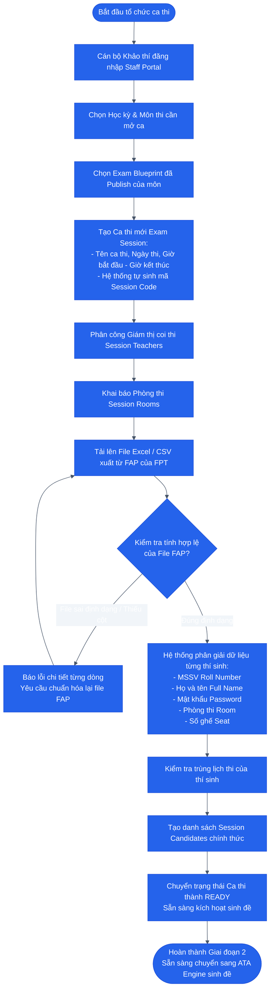

# SƠ ĐỒ HOẠT ĐỘNG: GIAI ĐOẠN 2 — KHẢO THÍ TỔ CHỨC CA THI & IMPORT FAP
## Examiner Session Setup & FAP Ingestion

### 1. Mục tiêu
Cán bộ Khảo thí (`EXAMINER`) tiếp nhận Ma trận đề đã được Ban Học thuật công bố, lập các ca thi cho môn học và **Import trực tiếp danh sách sinh viên đã được hệ thống FAP của Trường FPT xếp lịch sẵn** (gồm MSSV, Mật khẩu thi, Phòng thi, Số ghế).

---

### 2. Sơ đồ Hoạt động (Activity Diagram)

---

### 3. Đầu vào, Đầu ra & Thực thể dữ liệu liên quan

* **Tác tử thực hiện:** Cán bộ Khảo thí (`EXAMINER`) + File dữ liệu từ Hệ thống FAP.
* **Đầu vào (Input):**
  - Blueprint đã Publish từ Giai đoạn 1.
  - File Excel/CSV FAP gồm các cột: `RollNumber`, `FullName`, `Password`, `Room`, `SeatNumber`.
* **Đầu ra (Output):** `exam_session` ở trạng thái `READY` + danh sách `session_candidates` đã liên kết.
* **Thực thể dữ liệu (Database Tables):**
  - `schedule_slots` / `exam_sessions`
  - `exam_batches`
  - `course_candidates` / `session_candidates`
  - `slot_assignments`
