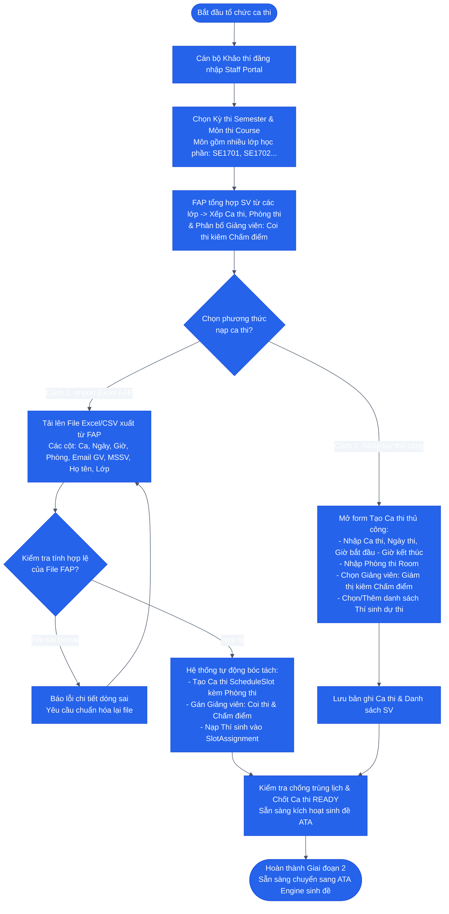

# SƠ ĐỒ HOẠT ĐỘNG: GIAI ĐOẠN 2 — KHẢO THÍ TỔ CHỨC CA THI & IMPORT FAP / NHẬP TAY
## Examiner Session Setup & FAP Ingestion / Manual Entry

### 1. Mục tiêu
Cán bộ Khảo thí (`EXAMINER`) thiết lập các ca thi cho môn học (môn học có thể có nhiều lớp học phần như SE1701, SE1702...). Hệ thống FAP của Trường FPT đã xếp lịch, gom sinh viên các lớp vào các ca thi, phân phòng thi và chỉ định Giảng viên coi thi kiêm chấm thi. Khảo thí có 2 phương thức nạp dữ liệu: **Import file Excel FAP** hoặc **Nhập tay thủ công (Manual Form)**.

---

### 2. Sơ đồ Hoạt động (Activity Diagram)

---

### 3. Đầu vào, Đầu ra & Thực thể dữ liệu liên quan

* **Tác tử thực hiện:** Cán bộ Khảo thí (`EXAMINER`) + File dữ liệu từ Hệ thống FAP.
* **Đầu vào (Input):**
  - Blueprint đã Publish từ Giai đoạn 1.
  - File Excel/CSV FAP gồm các cột: `RollNumber`, `FullName`, `Password`, `Room`, `SeatNumber`.
* **Đầu ra (Output):** `exam_session` ở trạng thái `READY` + danh sách `session_candidates` đã liên kết.
* **Thực thể dữ liệu (Database Tables):**
  - `schedule_slots` / `exam_sessions`
  - `exam_batches`
  - `course_candidates` / `session_candidates`
  - `slot_assignments`
