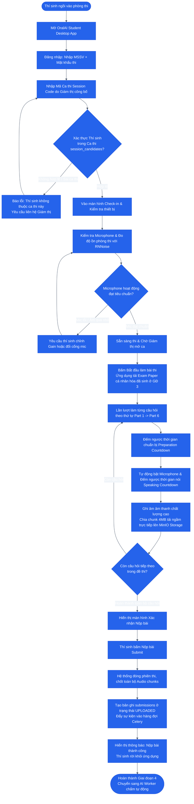

# SƠ ĐỒ HOẠT ĐỘNG: GIAI ĐOẠN 4 — THÍ SINH THAM GIA THI & NỘP BÀI
## Student Exam Experience & Real-Time Evidence Capture

### 1. Mục tiêu
Thí sinh (`STUDENT`) sử dụng ứng dụng chuyên dụng **OralAI Student Desktop App** (Electron Client) để đăng nhập, xác thực ca thi, kiểm tra mic, tải đề thi cá nhân hóa, làm bài ghi âm từng phần và nộp bài an toàn lên MinIO Storage.

---

### 2. Sơ đồ Hoạt động (Activity Diagram)

---

### 3. Đầu vào, Đầu ra & Thực thể dữ liệu liên quan

* **Tác tử thực hiện:** Thí sinh (`STUDENT`).
* **Đầu vào (Input):**
  - MSSV, Password, Session Code.
  - Đề thi `exam_papers` đã được sinh ở Giai đoạn 3.
  - Tín hiệu âm thanh Micro phòng thi.
* **Đầu ra (Output):**
  - File Audio raw minh chứng trên MinIO Object Storage.
  - Bản ghi `submissions` có trạng thái `UPLOADED`.
  - Các bản ghi `question_attempts` cho từng câu hỏi.
* **Thực thể dữ liệu (Database Tables):**
  - `exam_sessions`
  - `question_attempts` / `submissions`
  - `uploads` / MinIO Storage metadata
