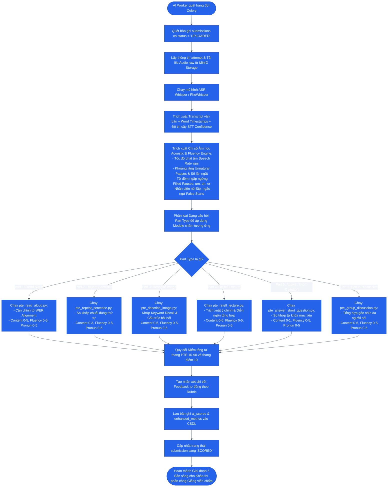

# SƠ ĐỒ HOẠT ĐỘNG: GIAI ĐOẠN 5 — AI WORKER CHẤM ĐIỂM TỰ ĐỘNG (BATCH)
## Multimodal AI Scoring Pipeline (PhoWhisper + Fluency + PTE Scoring)

### 1. Mục tiêu
Hệ thống **AI Worker** (chạy nền với Celery) tự động nhận diện bài nộp mới, tải audio minh chứng từ MinIO, chạy mô hình nhận dạng giọng nói (ASR), trích xuất các đặc trưng âm học (Acoustic Fluency), đối soát ngữ âm và ngữ nghĩa theo chuẩn quốc tế Pearson PTE và Rubric bộ môn, sau đó tính toán điểm chi tiết cho từng tiêu chí.

---

### 2. Sơ đồ Hoạt động (Activity Diagram)

---

### 3. Đầu vào, Đầu ra & Thực thể dữ liệu liên quan

* **Tác tử thực hiện:** Celery Worker chạy ngầm (Backend AI Service).
* **Đầu vào (Input):**
  - File Audio raw từ MinIO Storage.
  - Văn bản đề bài, câu mẫu (Sample Answer) và bộ từ khóa (Keywords).
* **Đầu ra (Output):**
  - `transcript` và dấu thời gian từng từ.
  - Chỉ số âm học `fluency_metrics`.
  - Điểm thành phần `scores` (Content, Fluency, Pronunciation).
  - Bản ghi `ai_scores` được gắn vào câu trả lời, trạng thái chuyển sang `SCORED`.
* **Thực thể dữ liệu (Database Tables):**
  - `question_attempts`
  - `ai_scores` / `enhanced_metrics`
  - `submissions`
