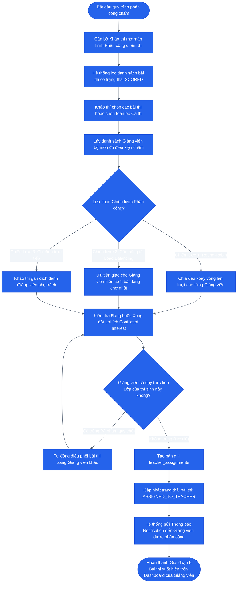

# SƠ ĐỒ HOẠT ĐỘNG: GIAI ĐOẠN 6 — KHẢO THÍ PHÂN CÔNG GIẢNG VIÊN CHẤM
## Examiner Grading Assignment & Workload Distribution

### 1. Mục tiêu
Cán bộ Khảo thí (`EXAMINER`) lựa chọn các bài thi đã được AI chấm xong (`SCORED`) và áp dụng chiến lược phân bổ tự động hoặc chỉ định thủ công để giao quyền hậu kiểm/chấm điểm cho các Giảng viên bộ môn (`TEACHER`), đảm bảo tính công bằng, cân bằng khối lượng công việc và tránh xung đột lợi ích.

---

### 2. Sơ đồ Hoạt động (Activity Diagram)

---

### 3. Đầu vào, Đầu ra & Thực thể dữ liệu liên quan

* **Tác tử thực hiện:** Cán bộ Khảo thí (`EXAMINER`).
* **Đầu vào (Input):**
  - Danh sách bài thi đã có điểm AI (`SCORED`).
  - Danh sách Giảng viên chấm thi (`users` có role `TEACHER`).
* **Đầu ra (Output):**
  - Các bản ghi `teacher_assignments`.
  - Thông báo giao việc tới tài khoản Giảng viên.
* **Thực thể dữ liệu (Database Tables):**
  - `schedule_slots` / `exam_sessions`
  - `teacher_assignments`
  - `users`
