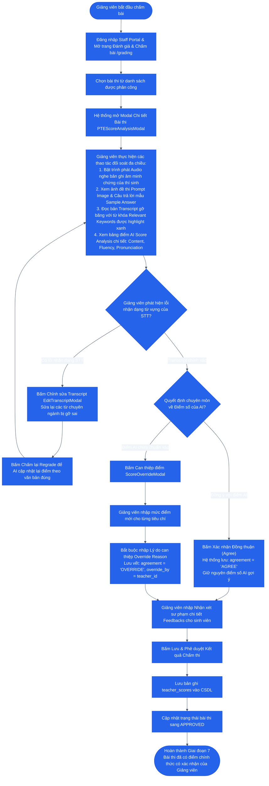

# SƠ ĐỒ HOẠT ĐỘNG: GIAI ĐOẠN 7 — GIẢNG VIÊN HẬU KIỂM & CHẤM ĐIỂM
## Teacher Review, Audio Evidence & Human-in-the-Loop Grading

### 1. Mục tiêu
Giảng viên chấm thi (`TEACHER`) thực hiện vai trò **Human-in-the-loop** (Giám sát con người): Mở bài thi được phân công trên Staff Portal (`/grading`), nghe âm thanh minh chứng, đối soát bản gỡ băng với từ khóa được highlight, xem điểm gợi ý của AI, và quyết định **Đồng thuận (Agree)** hoặc **Can thiệp điểm (Override)** kèm lý do minh chứng và nhận xét sư phạm.

---

### 2. Sơ đồ Hoạt động (Activity Diagram)

---

### 3. Đầu vào, Đầu ra & Thực thể dữ liệu liên quan

* **Tác tử thực hiện:** Giảng viên chấm thi (`TEACHER`).
* **Đầu vào (Input):**
  - Audio minh chứng lưu trên MinIO.
  - Điểm số và nhận xét từ `ai_scores`.
  - Transcript kèm từ khóa highlight.
* **Đầu ra (Output):**
  - Bản ghi điểm của Giảng viên `teacher_scores` (gồm cờ `AGREE` hoặc `OVERRIDE`).
  - Lý do can thiệp `override_reason` (nếu có).
  - Nhận xét phản hồi `feedback`.
  - Trạng thái bài thi chuyển thành `APPROVED`.
* **Thực thể dữ liệu (Database Tables):**
  - `question_attempts`
  - `assessments` / `teacher_scores`
  - `audit_logs`
