# SƠ ĐỒ HOẠT ĐỘNG TOÀN DIỆN (ACTIVITY DIAGRAM) — HƯỚNG 2
## Hệ thống Thi Vấn đáp Tự động Bằng AI (OralAI)
### Mô hình Tích hợp FAP, Sinh đề Độc lập (ATA) & Chấm thi Đa tác tử (10 Giai đoạn)

> 💡 **Tài liệu chính thức được lưu tại:** [`docs/diagrams/activity-diagram.md`](../docs/diagrams/activity-diagram.md)

---

## 1. Sơ đồ Hoạt động Phân làn (Swimlane Activity Diagram)

```mermaid
%%{init: {'theme': 'base', 'themeVariables': { 'primaryColor': '#2563eb', 'primaryTextColor': '#ffffff', 'primaryBorderColor': '#1d4ed8', 'lineColor': '#475569', 'secondaryColor': '#f1f5f9', 'tertiaryColor': '#ffffff'}}}%%
flowchart TD

    subgraph ACADEMIC ["🏛️ BAN HỌC THUẬT (ACADEMIC)"]
        A1(["Bắt đầu kỳ học"]) --> A2["Tạo Học kỳ (Term: Fall 2026)"]
        A2 --> A3["Tạo Môn học chuẩn (Course: ENG_SPK_1)"]
        A3 --> A4["Tạo Course Offering (Fall 2026 + ENG_SPK_1)"]
        A4 --> A5["Định nghĩa Rubric Template & Tiêu chí chi tiết"]
        A5 --> A6["Import / Quản lý Ngân hàng câu hỏi (Item Bank)\nPhân loại: Type + Level"]
        A6 --> A7["Thiết lập Exam Blueprint (Ma trận đề)\nQuy định số lượng câu theo Type & Level"]
        A7 --> A8["Công bố ma trận đề\n(Publish Blueprint - Đóng băng Snapshot)"]
    end

    subgraph FAP_EXAMINER ["📋 FAP & CÁN BỘ KHẢO THÍ (EXAMINER)"]
        E1["Hệ thống FAP của Trường đã xếp sẵn:\nLớp, Lịch thi, Ca thi, Phòng thi & Danh sách SV"]
        A8 --> E2["Examiner chọn Blueprint đã Publish"]
        E1 --> E3["Examiner tạo Ca thi (Exam Session)\nsinh mã Session Code"]
        E2 --> E3
        E3 --> E4["Gán Giám thị phòng thi (Session Teachers)"]
        E3 --> E5["Gán Phòng thi (Session Rooms)"]
        E4 & E5 --> E6["IMPORT File Excel từ FAP:\nDanh sách SV + Phòng thi + Số ghế (Seat)"]
    end

    subgraph ATA_ENGINE ["⚙️ ORALAI CORE & ATA ENGINE (SINH ĐỀ ĐỘC LẬP)"]
        E6 --> S1{"Kích hoạt sinh đề\ncho từng Thí sinh"}
        S1 --> S2["Đọc Ma trận Blueprint Sections"]
        S2 --> S3["Tạo mã Hash bất biến:\nseed = hash(student_id + session_code)"]
        S3 --> S4["Random ngẫu nhiên có kiểm soát từ Item Bank\ntheo đúng Type + Level quy định"]
        S4 --> S5["Đóng gói Đề thi riêng biệt (Exam Paper)\ngắn với từng thí sinh trong Ca thi"]
    end

    subgraph STUDENT ["🎓 THÍ SINH (STUDENT APP)"]
        ST1(["Thí sinh đến phòng thi"]) --> ST2["Đăng nhập Student App (MSSV + Password)"]
        ST2 --> ST3["Nhập mã Ca thi (Session Code)"]
        ST3 --> ST4{"Kiểm tra hợp lệ\n(Session Candidates)?"}
        ST4 -- "Không hợp lệ" --> ST_ERR["Báo lỗi / Liên hệ Giám thị"]
        ST4 -- "Hợp lệ" --> ST5["Check-in phòng thi & Kiểm tra Micro"]
        S5 -.->|Tải đề thi cá nhân hóa| ST6["Bắt đầu làm bài thi vấn đáp"]
        ST5 --> ST6
        ST6 --> ST7["Lần lượt ghi âm trả lời từng câu hỏi\n(Audio chia chunk tải lên MinIO)"]
        ST7 --> ST8["Hoàn thành & Bấm Nộp bài (Submit)"]
        ST8 --> ST9["Tạo Submissions (Status: UPLOADED)"]
    end

    subgraph AI_PIPELINE ["🤖 AI WORKER (CELERY & PHO-WHISPER & LLM)"]
        ST9 --> W1["Quét hàng đợi Submissions (Status = 'UPLOADED')"]
        W1 --> W2["Tải Audio minh chứng từ MinIO Storage"]
        W2 --> W3["ASR (Speech-to-Text Whisper):\nPhiên âm Transcript + Word Timestamps"]
        W3 --> W4["Trích xuất Âm học (Fluency Metrics):\nTốc độ nói wps, Ngập ngừng, Độ dừng, Pause count"]
        W4 --> W5["Đối soát Ngữ âm & Ngữ nghĩa (Pronunciation & Content)\nChấm chuẩn Pearson PTE / LLM Rubric"]
        W5 --> W6["Tổng hợp kết quả AI Score chi tiết từng tiêu chí\n(Status = 'SCORED')"]
    end

    subgraph GRADING ["👨‍🏫 PHÂN CÔNG & GIẢNG VIÊN CHẤM (TEACHER)"]
        W6 --> G1["Examiner chọn chiến lược phân công chấm\n(Round-Robin / Cân bằng tải)"]
        G1 --> G2["Tạo Teacher Assignments & Gửi thông báo"]
        G2 --> G3["Giảng viên mở màn hình Chấm thi (/grading)"]
        G3 --> G4["Nghe Audio minh chứng + Đối soát Transcript + Xem điểm AI"]
        G4 --> G5{"Giảng viên đồng thuận\nvới điểm AI?"}
        G5 -- "Đồng ý (Agree)" --> G6["Xác nhận điểm AI\n(agreement = 'AGREE')"]
        G5 -- "Can thiệp (Override)" --> G7["Điều chỉnh điểm & Nhập lý do minh chứng\n(agreement = 'OVERRIDE')"]
        G6 & G7 --> G8["Giảng viên viết Nhận xét chi tiết (Feedback)"]
        G8 --> G9["Khảo thí phê duyệt điểm chính thức\n(Status = 'APPROVED')"]
    end

    subgraph REVIEW_AUDIT ["📊 PHÚC KHẢO, XUẤT ĐIỂM & DỌN DẸP LƯU TRỮ"]
        G9 --> R1["Tính toán Final Results & Đóng băng kết quả"]
        R1 --> R2["Công bố điểm cho Thí sinh xem"]
        R1 --> R3["Xuất file Excel bảng điểm chuẩn format FAP\nnộp lại cho Phòng Đào tạo / Khảo thí"]
        
        R2 --> PK1{"Thí sinh có khiếu nại /\nPhúc khảo không?"}
        PK1 -- "Có phúc khảo" --> PK2["Tạo Regrade Request\n(Hủy lệnh xóa Audio, gán GV thứ 2 chấm mù)"]
        PK2 --> PK3["Giảng viên 2 thẩm định độc lập -> Chốt điểm phúc khảo"]
        PK3 --> R3
        
        PK1 -- "Không phúc khảo\n(Hết hạn phúc khảo + Buffer)" --> CL1["Cron Job quét Storage Cleanup Jobs"]
        CL1 --> CL2["Xóa file Audio raw khỏi MinIO Storage"]
        CL2 --> CL3["Cập nhật submissions.audio_deleted_at\nLưu trữ vĩnh viễn Audit Log & Transcript"]
        CL3 --> END_NODE(["Kết thúc Kỳ thi"])
    end
```

---

## 2. Tóm tắt 10 Giai đoạn Vận hành

| Giai đoạn | Tên Giai đoạn | Tác tử chịu trách nhiệm | Hành động chính |
| :---: | :--- | :--- | :--- |
| **GĐ 1** | Chuẩn bị Học vụ | Ban Học thuật (Academic) | Tạo Term, Course, Course Offering, Rubric, Item Bank & Publish Blueprint |
| **GĐ 2** | Tổ chức Ca thi | Khảo thí (Examiner) & FAP | Chọn Blueprint, tạo Exam Session, gán Giám thị & **Import danh sách FAP** |
| **GĐ 3** | Hệ thống Sinh đề | OralAI Core (ATA Engine) | Bốc câu hỏi ngẫu nhiên theo `seed = hash(student_id + session_code)` |
| **GĐ 4** | Sinh viên Làm bài | Thí sinh (Student) | Đăng nhập Desktop App, check-in, ghi âm nộp từng câu hỏi lên MinIO |
| **GĐ 5** | AI Chấm tự động | AI Worker (Celery/Whisper/LLM) | ASR phiên âm, đo trôi chảy, đối soát phát âm & chấm rubric theo Part |
| **GĐ 6** | Phân công Giảng viên | Khảo thí (Examiner) | Phân công bài thi theo Round-Robin hoặc cân bằng tải |
| **GĐ 7** | Hậu kiểm & Chấm điểm | Giảng viên (Teacher) | Xem điểm AI, nghe audio, bấm **Agree** hoặc **Override** kèm lý do & feedback |
| **GĐ 8** | Xử lý Phúc khảo | Thí sinh, Khảo thí, GV 2 | Nhận đơn phúc khảo $\rightarrow$ Hủy xóa audio $\rightarrow$ Giảng viên 2 chấm mù |
| **GĐ 9** | Tổng hợp & Báo cáo FAP | Hệ thống & Khảo thí | Công bố điểm cho SV, xuất file Excel chuẩn format FAP nộp trường, lưu Audit log |
| **GĐ 10** | Dọn dẹp Tài nguyên | Cron Job tự động | Quét dọn MinIO xóa audio dung lượng lớn sau kỳ thi; giữ vĩnh viễn text/điểm |
