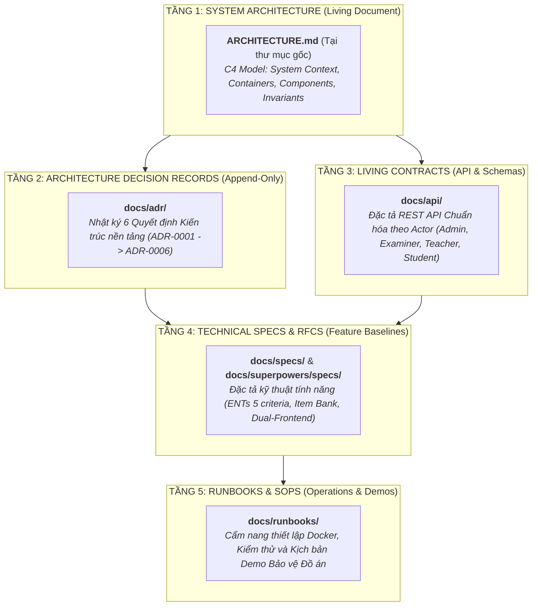

# TRUNG TÂM TÀI LIỆU KỸ THUẬT (ORALAI DOCUMENTATION PORTAL)

> **Dự án:** AI Oral Assessment Platform (Hệ thống Thi vấn đáp Tự động bằng AI)  
> **Chủ sở hữu:** Nguyễn Văn Gia Bình & Nhóm NCKH / Đồ án Tốt nghiệp CNTT  
> **Phương pháp quản lý:** **Docs-as-Code & Sustainable Architecture Documentation**

Chào mừng bạn đến với Trung tâm Tài liệu Kỹ thuật của dự án **AI Oral Assessment Platform**. Toàn bộ tài liệu được tổ chức theo mô hình **5 Tầng Kiến Trúc Bền Vững**, phân tách rạch ròi giữa các quyết định mang tính bất biến và các đặc tả phát triển theo từng sprint.

---

## 1. BẢN ĐỒ PHÂN TẦNG TÀI LIỆU (5-LAYER ARCHITECTURE MAP)

---

## 2. DANH MỤC CHI TIẾT TỪNG PHÂN KHU (MAP OF CONTENT)

### 🏛️ Tầng 1: Kiến trúc Tổng thể Sống (Living Architecture)
* [**`ARCHITECTURE.md`**](file:///c:/Users/admin/Documents/A_FPT/Tempory_Project/AI-Oral-Assessment-Platform/ARCHITECTURE.md): Bản đồ kiến trúc toàn diện theo mô hình C4 (Level 1 Context, Level 2 Containers, Level 3 Components), 5 nguyên tắc kiến trúc bất biến, luồng dữ liệu E2E và bảng cổng mạng Docker.

---

### 📜 Tầng 2: Quyết định Kiến trúc Bất biến (ADRs — `docs/adr/`)
*Toàn bộ các quyết định chiến lược có giá trị pháp lý và kỹ thuật lâu dài (Append-Only):*
* [**`docs/adr/README.md`**](file:///c:/Users/admin/Documents/A_FPT/Tempory_Project/AI-Oral-Assessment-Platform/docs/adr/README.md): Tổng quan quy trình, định dạng MADR và chỉ mục.
* [**ADR-0001: Record Architecture Decisions**](file:///c:/Users/admin/Documents/A_FPT/Tempory_Project/AI-Oral-Assessment-Platform/docs/adr/0001-record-architecture-decisions.md) — Ghi nhận các quyết định kiến trúc.
* [**ADR-0002: Server-Side STT & Anti-Tampering**](file:///c:/Users/admin/Documents/A_FPT/Tempory_Project/AI-Oral-Assessment-Platform/docs/adr/0002-server-side-stt-anti-tampering.md) — Bỏ STT local, Student App thành Thin-Client chống gian lận.
* [**ADR-0003: Dual-Frontend & Strangler Fig Pattern**](file:///c:/Users/admin/Documents/A_FPT/Tempory_Project/AI-Oral-Assessment-Platform/docs/adr/0003-dual-frontend-strangler-pattern.md) — Tách Student App Desktop và Staff Portal Next.js.
* [**ADR-0004: Exam Snapshot Freeze Policy**](file:///c:/Users/admin/Documents/A_FPT/Tempory_Project/AI-Oral-Assessment-Platform/docs/adr/0004-exam-snapshot-freeze-policy.md) — Đóng băng đề thi, Rubric và RAG khi công bố kỳ thi.
* [**ADR-0005: ENTs 5-Criteria Speaking Grading Framework**](file:///c:/Users/admin/Documents/A_FPT/Tempory_Project/AI-Oral-Assessment-Platform/docs/adr/0005-ents-5criteria-grading-framework.md) — Chuẩn hóa thang điểm 10 ENTs 5 tiêu chí.
* [**ADR-0006: Dual-Auth Cookie & Bearer JWT**](file:///c:/Users/admin/Documents/A_FPT/Tempory_Project/AI-Oral-Assessment-Platform/docs/adr/0006-dual-auth-cookie-and-bearer-jwt.md) — HttpOnly Cookie cho Web và RAM Token cho Desktop.

---

### 🔌 Tầng 3: Đặc tả Giao tiếp & Hợp đồng API (`docs/api/`)
*Đặc tả REST API phân tách rành mạch theo từng Actor tham gia hệ thống:*
* [**`docs/api/README.md`**](file:///c:/Users/admin/Documents/A_FPT/Tempory_Project/AI-Oral-Assessment-Platform/docs/api/README.md): Tổng quan RBAC, Dual-Auth và quy ước phản hồi lỗi.
* [**00 - Auth & Common API**](file:///c:/Users/admin/Documents/A_FPT/Tempory_Project/AI-Oral-Assessment-Platform/docs/api/00-auth-and-common.md): Đăng nhập, Cookie, JWT, Profile và Refresh.
* [**01 - System Admin API**](file:///c:/Users/admin/Documents/A_FPT/Tempory_Project/AI-Oral-Assessment-Platform/docs/api/01-system-admin-api.md): Quản trị người dùng, cấu hình AI và hệ thống.
* [**02 - Examiner API**](file:///c:/Users/admin/Documents/A_FPT/Tempory_Project/AI-Oral-Assessment-Platform/docs/api/02-examiner-api.md): Quản lý Học kỳ, Ca thi, Phê duyệt điểm và Khóa sổ.
* [**03 - Teacher API**](file:///c:/Users/admin/Documents/A_FPT/Tempory_Project/AI-Oral-Assessment-Platform/docs/api/03-teacher-api.md): Lịch coi thi (`/teacher/schedule`), Phòng thi (`/teacher/proctor`), Chấm phúc khảo (`/teacher/results/override`).
* [**04 - Student API**](file:///c:/Users/admin/Documents/A_FPT/Tempory_Project/AI-Oral-Assessment-Platform/docs/api/04-student-api.md): Khởi tạo phiên thi, nhận câu hỏi động, nộp file âm thanh/video.

---

### 📐 Tầng 4: Đặc tả Thiết kế Tính năng (Specs & RFCs — `docs/specs/`)
*Tài liệu thiết kế chi tiết từng tính năng lớn trước khi triển khai mã nguồn:*
* [**`docs/specs/README.md`**](file:///c:/Users/admin/Documents/A_FPT/Tempory_Project/AI-Oral-Assessment-Platform/docs/specs/README.md): Mục lục và nguyên tắc duy trì Technical Specs.
* [**Spec Chấm điểm ENTs Speaking 5 Tiêu chí**](file:///c:/Users/admin/Documents/A_FPT/Tempory_Project/AI-Oral-Assessment-Platform/docs/superpowers/specs/2026-10-20-ents-speaking-5criteria-grading-design.md): Phân tích công thức điểm, 4 band điểm, thuật toán Whisper logprobs và LLM Prompting.
* [**Kế hoạch Triển khai ENTs Speaking 5 Tiêu chí**](file:///c:/Users/admin/Documents/A_FPT/Tempory_Project/AI-Oral-Assessment-Platform/docs/superpowers/plans/2026-10-20-ents-speaking-5criteria-grading.md): Kế hoạch dọn dẹp, phát triển AI Hybrid Calibration, Seeder 6 môn và lộ trình kiểm thử E2E.
* [**Spec Ngân hàng Câu hỏi & Ma trận Đề thi**](file:///c:/Users/admin/Documents/A_FPT/Tempory_Project/AI-Oral-Assessment-Platform/docs/superpowers/plans/2026-10-12-academic-exam-bank-and-matrix.md): CSDL Item Bank, Blueprint Matrix, Stock Health Validator.
* [**Spec Examiner Exam Management**](file:///c:/Users/admin/Documents/A_FPT/Tempory_Project/AI-Oral-Assessment-Platform/docs/superpowers/specs/2026-10-06-examiner-exam-management-design.md): Quy trình tổ chức thi từ FAP Import đến Xuất điểm.
* [**Spec Luồng Thi Nói Tiếng Anh**](file:///c:/Users/admin/Documents/A_FPT/Tempory_Project/AI-Oral-Assessment-Platform/docs/specs/demo-flow-english-speaking.md): Luồng tương tác của thí sinh trong phòng thi.
* [**Kế hoạch Triển khai Đánh giá Nói**](file:///c:/Users/admin/Documents/A_FPT/Tempory_Project/AI-Oral-Assessment-Platform/docs/specs/speaking-assessment-implementation-plan.md): Lộ trình nâng cấp thuật toán chấm thi.

---

### 🛠️ Tầng 5: Cẩm nang Vận hành & Thực hành Chuẩn (Runbooks & SOPs — `docs/runbooks/`)
*Hướng dẫn thực hành thao tác từng bước:*
* [**`docs/runbooks/README.md`**](file:///c:/Users/admin/Documents/A_FPT/Tempory_Project/AI-Oral-Assessment-Platform/docs/runbooks/README.md): Quy tắc vận hành và chỉ mục Runbooks.
* [**RUNBOOK-01: Local Dev & Docker Cluster**](file:///c:/Users/admin/Documents/A_FPT/Tempory_Project/AI-Oral-Assessment-Platform/docs/runbooks/01-local-dev-and-docker-setup.md): Hướng dẫn khởi chạy 6 Docker containers, biến môi trường, dev servers.
* [**RUNBOOK-02: Testing & Verification Suite**](file:///c:/Users/admin/Documents/A_FPT/Tempory_Project/AI-Oral-Assessment-Platform/docs/runbooks/02-testing-and-verification-suite.md): Quy trình chạy Typecheck 3 workspaces, Pytest backend, Vitest shared.
* [**RUNBOOK-03: Demo Seeding & Defense Showcase**](file:///c:/Users/admin/Documents/A_FPT/Tempory_Project/AI-Oral-Assessment-Platform/docs/runbooks/03-demo-seeding-and-defense-showcase.md): Danh sách tài khoản chuẩn, script seed dữ liệu và kịch bản trình diễn 5 hồi bảo vệ đồ án.

---

### 🔬 Nghiên cứu Khoa học & Cơ sở Học thuật (`docs/research/`)
*Các bài báo, tổng quan lý thuyết và cơ sở khoa học phục vụ báo cáo NCKH / Đồ án:*
* [**Cơ sở Khoa học & Báo cáo Bảo vệ**](file:///c:/Users/admin/Documents/A_FPT/Tempory_Project/AI-Oral-Assessment-Platform/docs/research/scientific-foundation-and-defense-report.md)
* [**Giải pháp Đánh giá Nói Tối ưu (Optimal Speaking Assessment Solution)**](file:///c:/Users/admin/Documents/A_FPT/Tempory_Project/AI-Oral-Assessment-Platform/docs/research/optimal-speaking-assessment-solution.md)
* [**Danh sách 11 Bài báo & Phân tích Loại trừ**](file:///c:/Users/admin/Documents/A_FPT/Tempory_Project/AI-Oral-Assessment-Platform/docs/research/danh-sach-11-bai-bao-va-ly-do-loai-bo.md)
* [**12 Bước Triển khai Đã Định dạng**](file:///c:/Users/admin/Documents/A_FPT/Tempory_Project/AI-Oral-Assessment-Platform/docs/research/Twelve_Steps_Da_Dinh_Dang.md)
* [**Giáo trình mẫu Software Testing PDF**](file:///c:/Users/admin/Documents/A_FPT/Tempory_Project/AI-Oral-Assessment-Platform/docs/research/giao_trinh_mau_software_testing.pdf)

---

### 📊 Sơ đồ Nghiệp vụ & Luồng Dữ liệu (`docs/diagrams/`)
*10 Sơ đồ quy trình nghiệp vụ chuẩn định dạng Draw.io và Activity Diagrams:*
* [**`docs/diagrams/README.md`**](file:///c:/Users/admin/Documents/A_FPT/Tempory_Project/AI-Oral-Assessment-Platform/docs/diagrams/README.md): Bảng ánh xạ 10 quy trình nghiệp vụ từ Học vụ, Khảo thí, Sinh viên, AI Worker, Giảng viên đến Dọn dẹp dữ liệu MinIO.
* [**Activity Diagrams Chi tiết**](file:///c:/Users/admin/Documents/A_FPT/Tempory_Project/AI-Oral-Assessment-Platform/docs/diagrams/activity-diagram.md)

---

### 📦 Lưu trữ & Lịch sử Dự án (`docs/archive/`)
*Tài liệu bàn giao, ghi chú MVP cũ phục vụ mục đích tra cứu lịch sử:*
* `docs/archive/legacy-notes/`: Bàn giao công việc cũ, biên bản demo, ghi chú thiết lập microphone.
* `docs/archive/legacy-mvp/`: Mã nguồn và ghi chú MVP ban đầu.

---

### 🚀 Tài liệu Bắt đầu Nhanh (Quick Start)
* [**QUICK_START.md**](file:///c:/Users/admin/Documents/A_FPT/Tempory_Project/AI-Oral-Assessment-Platform/docs/QUICK_START.md): Hướng dẫn nhanh cho người mới bắt đầu.
* [**user-guide.md**](file:///c:/Users/admin/Documents/A_FPT/Tempory_Project/AI-Oral-Assessment-Platform/docs/user-guide.md): Cẩm nang hướng dẫn người dùng cuối.
