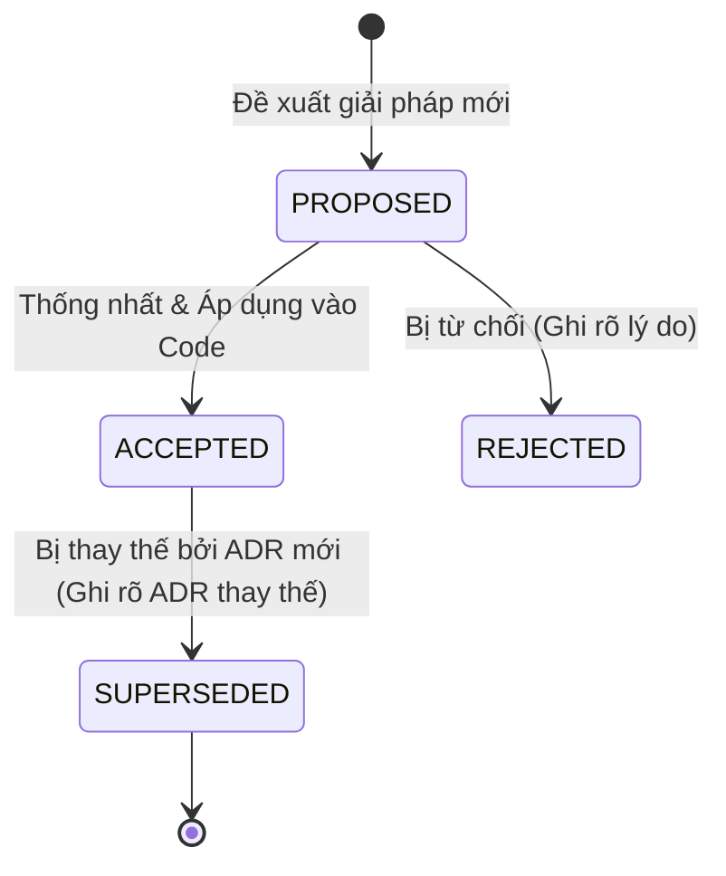

# BẢNG GHI NHẬN QUYẾT ĐỊNH KIẾN TRÚC (ARCHITECTURE DECISION RECORDS - ADR)

> **Dự án:** AI Oral Assessment Platform
> **Phương pháp luận:** Michael Nygard / MADR (Markdown Architecture Decision Records)
> **Nguyên tắc cốt lõi:** **APPEND-ONLY (Chỉ thêm mới, không bao giờ xóa hay sửa đè lịch sử)**

---

## 1. ADR là gì và Tại sao dự án áp dụng ADR?

**ADR (Architecture Decision Record)** là tài liệu ngắn gọn, ghi lại **Bối cảnh (Context)**, **Quyết định (Decision)**, và **Hệ quả / Đánh đổi (Consequences/Trade-offs)** tại thời điểm ra quyết định.

---

## 2. Vòng đời của một ADR (ADR Lifecycle)

Mỗi bản ghi ADR có một trong các trạng thái sau:

* **`PROPOSED`:** Đang trong quá trình thảo luận / Review kỹ thuật.
* **`ACCEPTED`:** Đã được phê duyệt và đang có hiệu lực trong codebase.
* **`REJECTED`:** Đã thảo luận nhưng bị bác bỏ vì không khả thi hoặc không phù hợp.
* **`SUPERSEDED`:** Từng được áp dụng nhưng sau đó đã bị một ADR mới hơn thay thế (Ví dụ: ADR-0005 thay thế cơ chế chấm điểm cũ của PTE).

---

## 3. Danh mục các Quyết định Kiến trúc (ADR Index)

| Mã ADR                                                                                                                                         | Tiêu đề Quyết định                                                                  | Trạng thái | Ngày phê duyệt | Tác giả / Người quyết định |
| :---------------------------------------------------------------------------------------------------------------------------------------------- | :---------------------------------------------------------------------------------------- | :----------- | :---------------- | :-------------------------------- |
| [ADR-0001](file:///c:/Users/admin/Documents/A_FPT/Tempory_Project/AI-Oral-Assessment-Platform/docs/adr/0001-record-architecture-decisions.md)    | Ghi nhận các Quyết định Kiến trúc (Record Architecture Decisions)                  | `ACCEPTED` | 2026-09-25        | Bình                             |
| [ADR-0002](file:///c:/Users/admin/Documents/A_FPT/Tempory_Project/AI-Oral-Assessment-Platform/docs/adr/0002-server-side-stt-anti-tampering.md)   | Chuyển toàn bộ STT lên Server & Biến Desktop App thành Thin-Client Chống gian lận | `ACCEPTED` | 2026-09-28        | Bình                             |
| [ADR-0003](file:///c:/Users/admin/Documents/A_FPT/Tempory_Project/AI-Oral-Assessment-Platform/docs/adr/0003-dual-frontend-strangler-pattern.md)  | Phân tách Dual-Frontend và Tái cấu trúc theo Strangler Fig Pattern                  | `ACCEPTED` | 2026-09-30        | Bình                             |
| [ADR-0004](file:///c:/Users/admin/Documents/A_FPT/Tempory_Project/AI-Oral-Assessment-Platform/docs/adr/0004-exam-snapshot-freeze-policy.md)      | Đóng băng toàn bộ Dữ liệu Đề thi (Snapshot Freeze) khi Công bố Kỳ thi         | `ACCEPTED` | 2026-10-02        | Bình                             |
| [ADR-0005](file:///c:/Users/admin/Documents/A_FPT/Tempory_Project/AI-Oral-Assessment-Platform/docs/adr/0005-ents-5criteria-grading-framework.md) | Chuyển đổi Khung chấm điểm Speaking sang Chuẩn ENTs 5 Tiêu chí Thang điểm 10   | `ACCEPTED` | 2026-10-20        | Bình                             |
| [ADR-0006](file:///c:/Users/admin/Documents/A_FPT/Tempory_Project/AI-Oral-Assessment-Platform/docs/adr/0006-dual-auth-cookie-and-bearer-jwt.md)  | Cơ chế Xác thực Kép: HttpOnly Cookie cho Web Portal và In-Memory JWT cho Desktop    | `ACCEPTED` | 2026-10-03        | Bình                             |
