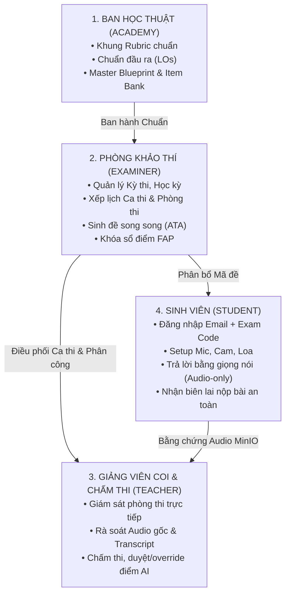
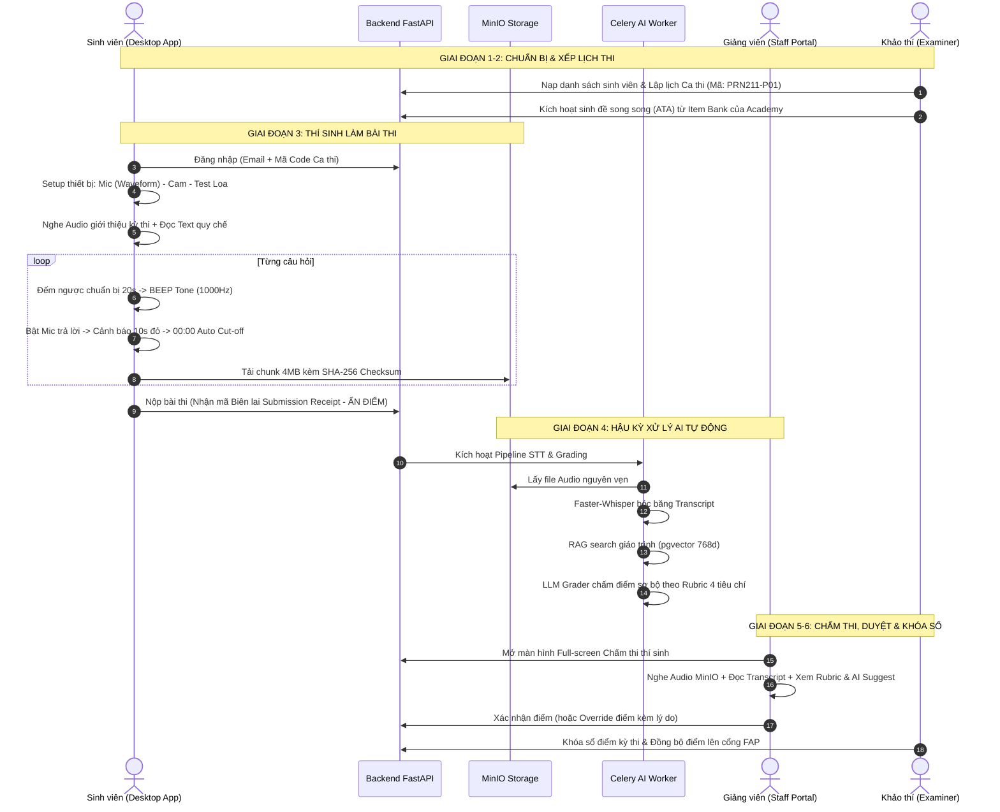

# BÁO CÁO TỔNG QUAN HỆ THỐNG & ĐẶC TẢ VẬN HÀNH TOÀN TRÌNH
## NỀN TẢNG THI VẤN ĐÁP TỰ ĐỘNG BẰNG AI (ORALAI PLATFORM DOSSIER)

> **Dự án:** Nền tảng Khảo thí Vấn đáp Tự động trên Máy tính tích hợp AI (AI-Powered Oral Assessment Platform)  
> **Đơn vị:** Khoa Công nghệ Thông tin — Trường Đại học FPT  
> **Sinh viên thực hiện:** Nguyễn Văn Gia Bình (Bình)  
> **Kính gửi:** Thầy Cán bộ Hướng dẫn Đồ án / Nghiên cứu Khoa học  
> **Thời gian cập nhật:** Tháng 10/2026 (Phiên bản đồng bộ sau buổi Review ngày 11/10/2026)  
> **Mã tài liệu:** `DOCS-ORALAI-SYSTEM-DOSSIER-V2.0`

---

## MỤC LỤC TỔNG QUAN

1. [PHẦN 1: BỐI CẢNH DỰ ÁN & CƠ SỞ KHOA HỌC KHẢO THÍ](#phần-1-bối-cảnh-dự-án--cơ-sở-khoa-học-khảo-thí)
2. [PHẦN 2: BẢN ĐỒ KIẾN TRÚC & PHÂN ĐỊNH 4 VAI TRÒ (RBAC)](#phần-2-bản-đồ-kiến-trúc--phân-định-4-vai-trò-rbac)
3. [PHẦN 3: QUY TRÌNH VẬN HÀNH TOÀN TRÌNH (END-TO-END WORKFLOW)](#phần-3-quy-trình-vận-hành-toàn-trình-end-to-end-workflow)
4. [PHẦN 4: NÂNG CẤP TRẢI NGHIỆM STUDENT APP (THEO CHỈ ĐẠO CỦA THẦY)](#phần-4-nâng-cấp-trải-nghiệm-student-app-theo-chỉ-đạo-của-thầy)
5. [PHẦN 5: NÂNG CẤP MÀN HÌNH CHẤM THI CỦA GIẢNG VIÊN (STAFF PORTAL)](#phần-5-nâng-cấp-màn-hình-chấm-thi-của-giảng-viên-staff-portal)
6. [PHẦN 6: HIỆN TRẠNG TRIỂN KHAI & BẰNG CHỨNG KIỂM THỬ THỰC TẾ](#phần-6-hiện-trạng-triển-khai--bằng-chứng-kiểm-thử-thực-tế)
7. [PHẦN 7: LỘ TRÌNH TRIỂN KHAI & CÂU HỎI XIN Ý KIẾN CHỈ ĐẠO CỦA THẦY](#phần-7-lộ-trình-triển-khai--câu-hỏi-xin-ý-kiến-chỉ-đạo-của-thầy)

---

## PHẦN 1: BỐI CẢNH DỰ ÁN & CƠ SỞ KHOA HỌC KHẢO THÍ

### 1.1. Nỗi đau thực tiễn của Hình thức Thi Vấn đáp Truyền thống
Thi vấn đáp (Oral Exam / Speaking Assessment) là phương pháp đánh giá chuẩn mực cao nhất để đo lường năng lực phản biện, tư duy logic và kỹ năng ngôn ngữ của sinh viên. Tuy nhiên, tại các trường đại học quy mô lớn, hình thức này gặp phải 4 nút thắt nghiêm trọng:
1. **Thiếu tính chuẩn hóa & Độ lệch cảm tính:** Cùng một môn học nhưng sinh viên thi ở các bàn hỏi thi khác nhau nhận điểm số chênh lệch lớn do tiêu chí chủ quan của từng giám khảo.
2. **Chi phí nhân lực & Thời gian khổng lồ:** Mỗi ca thi vấn đáp 1-1 kéo dài từ 15-20 phút/sinh viên. Với quy mô hàng nghìn sinh viên, giảng viên phải ngồi hội đồng liên tục nhiều ngày, dẫn đến mệt mỏi và suy giảm độ chính xác khi chấm về cuối ngày.
3. **Nguy cơ rò rỉ đề giữa các ca thi:** Các thí sinh thi ca sau thường dò hỏi đề từ ca trước, phá vỡ tính bảo mật và công bằng.
4. **Thiếu bằng chứng pháp lý bất biến để phúc khảo:** Khi sinh viên khiếu nại điểm, hội đồng chỉ có biên bản chấm tay vắn tắt, không có bản ghi âm/hình ảnh đầy đủ để đối soát độc lập.

### 1.2. Cơ sở Khoa học: Khung Đo lường Giáo dục Steven M. Downing (12 Steps)
Nền tảng **OralAI** được xây dựng nghiêm ngặt theo khung đo lường giáo dục 12 bước của **Steven M. Downing** (*Twelve Steps for Effective Test Development*), bảo đảm giá trị khoa học vững chắc:
* **Bước 1-3 (Thiết kế & Khung chuẩn):** Xây dựng Ma trận đề thi chuẩn (*Master Test Blueprint*), Chuẩn đầu ra (*Learning Outcomes - LO*) và Cây chủ đề (*Topic Hierarchy*).
* **Bước 4-6 (Ngân hàng câu hỏi & Lắp ráp đề):** Câu hỏi được chuẩn hóa trong Ngân hàng đề (*Item Bank*). Hệ thống sử dụng thuật toán Lắp ráp Đề thi Tự động (*Automated Test Assembly - ATA*) để sinh các mã đề thi song song (*Parallel Variants*) cho từng ca thi, bảo đảm độ khó và cấu trúc tương đương nhưng không trùng câu hỏi.
* **Bước 7-9 (Khảo thí & Chấm điểm chuẩn hóa):** Thi vấn đáp trên máy tính, bóc băng và chấm điểm tự động giới hạn nghiêm ngặt theo Khung Rubric chuẩn (*Rubric-Bounded AI Grading*).
* **Bước 10-12 (Phân tích chất lượng & Hậu kiểm):** Đối soát bằng chứng gốc, phúc khảo chấm mù 2 giám khảo độc lập, xuất báo cáo độ tin cậy.

### 1.3. Đối sánh Khảo thí Quốc tế (International Benchmarking)
Hệ thống học hỏi các tiêu chuẩn khắt khe từ 4 kỳ thi trên máy tính hàng đầu thế giới:

```
[IELTS on Computer] ──┐
[Pearson PTE]        ──┼──> [CHUẨN HÓA NỀN TẢNG ORALAI]
[TOEFL iBT Speaking] ──┤    • Zero-Playback (Không nghe lại)
[Duolingo English]   ──┘    • 1 Attempt (Chính quy)
                            • Auto Cut-off 00:00 + Beep Tone
                            • Bằng chứng Audio/Video bất biến MinIO
```

| Tiêu chuẩn Khảo thí | IELTS / PTE / TOEFL iBT | Duolingo English Test | Nền tảng OralAI (Đề xuất) |
| :--- | :--- | :--- | :--- |
| **Đăng nhập** | Mã thi + PIN ca thi của Giám thị | Email cá nhân | **Email + Mã Code Ca thi (Exam PIN)** |
| **Kiểm tra thiết bị**| Test Mic, Cam, Loa bắt buộc | Test Mic, Cam bắt buộc | **Check Mic (Waveform) - Cam - Test Loa** |
| **Tín hiệu Bắt đầu**| Tiếng Beep sau Countdown chuẩn bị| Thanh đếm ngược đổi màu | **Countdown chuẩn bị $\rightarrow$ Beep Tone $\rightarrow$ Bật Mic** |
| **Cảnh báo 10s cuối**| Timer nhấp nháy đỏ | Thanh tiến trình chuyển màu đỏ | **Timer đỏ + Soft Warning Chime** |
| **Hết giờ (Cut-off)**| Tự động ngắt mic và nộp bài | 00:00 tự động chuyển câu | **Auto Cut-off 00:00 + End Chime + Upload** |
| **Nghe lại (Playback)?**| ❌ **TUYỆT ĐỐI KHÔNG** | ❌ **TUYỆT ĐỐI KHÔNG** | ❌ **TUYỆT ĐỐI KHÔNG (Bảo vệ phản xạ tự nhiên)** |
| **Thi lại (Retake)?** | ❌ Chỉ 1 lần duy nhất | ❌ Chỉ 1 lần duy nhất | ❌ **Chính quy: 1 lần (Cần Giám thị reset)**<br>✅ **Luyện tập: Làm lại tự do** |
| **Xem điểm sau thi?** | ❌ Công bố sau vài ngày | ❌ Gửi sau 48h | ❌ **ẨN ĐIỂM (Cấp Biên lai Submission Receipt)**|

---

## PHẦN 2: BẢN ĐỒ KIẾN TRÚC & PHÂN ĐỊNH 4 VAI TRÒ (RBAC)

### 2.1. Kiến trúc Monorepo & Dual-Frontend
Hệ thống tách biệt hoàn toàn giữa ứng dụng Desktop của thí sinh và Cổng điều hành Web của Cán bộ:

```
┌─────────────────────────────────────────────────────────────────────────────┐
│                          HỆ THỐNG ORALAI MONOREPO                           │
├──────────────────────────────────────┬──────────────────────────────────────┤
│ CLIENT DESKTOP: apps/student-app     │ WEB PORTAL: apps/staff-portal        │
│ • Electron 33 + Vite + React 18      │ • Next.js 15 App Router + Tailwind   │
│ • Thin-Client bảo mật chống gian lận │ • Phân quyền RBAC 3 vai trò cán bộ   │
│ • RNNoise WASM lọc ồn real-time      │ • Giám sát thi, chấm thi, phúc khảo  │
│ • ChunkedUploader 4MB SHA-256 MinIO  │ • Quản lý học liệu RAG, ma trận đề   │
├──────────────────────────────────────┴──────────────────────────────────────┤
│ CORE BACKEND & AI WORKER: services/api                                      │
│ • FastAPI (Python 3.12+): Dual-Auth (JWT Bearer cho App, HttpOnly cho Web)  │
│ • Background Worker (Celery + Redis):                                       │
│   ├── STT Pipeline: Faster-Whisper (Server-side từ audio MinIO)             │
│   ├── RAG Engine: PostgreSQL 16 + pgvector (Embedding 768 chiều)            │
│   └── Grading Engine: LLM (Ollama / Gemini) chấm điểm chuẩn theo Rubric     │
│ • Storage: MinIO Object Storage (Audio/Video bài thi & Giáo trình PDF)       │
└─────────────────────────────────────────────────────────────────────────────┘
```

### 2.2. Chuẩn hóa 4 Vai trò Đại học Chuẩn mực (Strict RBAC)



### 2.3. 5 Nguyên tắc Bất biến khi Code (Architectural Invariants)
1. **Server là Source of Truth:** Không bao giờ tin tưởng client. Thời gian thi, nội dung câu hỏi, mã đề và điểm số 100% do Server tính toán và kiểm soát.
2. **Server-Side STT & Anti-Tampering:** Student App là Thin-Client — không chạy STT trên máy thí sinh, không sinh transcript trên máy client, không cho phép gõ bàn phím câu trả lời. Audio/Video gốc gửi thẳng lên MinIO làm bằng chứng pháp lý bất biến.
3. **Zero AI Question Generation:** AI tuyệt đối không tự bịa câu hỏi trong phòng thi. 100% câu hỏi được rút từ Ngân hàng câu hỏi đã qua thẩm định chuyên môn (Item Bank) theo Ma trận đề (Blueprint).
4. **Exam Snapshot Versioning:** Khi đề thi chuyển sang trạng thái `PUBLISHED`, toàn bộ RAG documents, Rubric và cấu hình chấm thi tại thời điểm đó được đóng băng (Freeze). Dù giáo trình có cập nhật sau này thì các bài thi cũ vẫn chấm theo snapshot lúc công bố.
5. **Immutable Evidence (Bằng chứng Bất biến):** File ghi âm chia chunk 4MB kèm mã băm SHA-256 là căn cứ pháp lý duy nhất để Giám khảo rà soát và hội đồng xử lý phúc khảo.

---

## PHẦN 3: QUY TRÌNH VẬN HÀNH TOÀN TRÌNH (END-TO-END WORKFLOW)

Quy trình khảo thí vấn đáp gồm 6 giai đoạn khép kín:



---

## PHẦN 4: NÂNG CẤP TRẢI NGHIỆM STUDENT APP (THEO CHỈ ĐẠO CỦA THẦY)

### 4.1. Đăng nhập Contextual Auth & Luồng Setup Thiết bị
* **Hình thức đăng nhập:** Sinh viên không dùng tài khoản/mật khẩu chung chung. Sử dụng **Email FPT + Mã Code Ca thi (Exam PIN)** được giám thị cấp tại phòng thi.
* **Luồng chuyển trang:** Ngay sau khi nhập mã hợp lệ, hệ thống bỏ qua các màn hình danh sách dư thừa, **điều hướng thẳng vào Màn hình Setup Thiết bị** gồm 3 bước:
  1. *Microphone Check:* Hiển thị thanh đo mức âm lượng thực tế (Audio Level Waveform).
  2. *Camera Check:* Khung hình video trực tiếp bảo đảm góc quay rõ khuôn mặt.
  3. *Speaker/Headphone Test:* Nút bấm phát âm thanh mẫu ("Bấm để nghe thử âm thanh"). Sinh viên xác nhận "Nghe rõ" mới cho phép vào thi.

### 4.2. Giải quyết dứt điểm 2 câu hỏi nghiệp vụ Thầy đặt ra
1. **Có cho phép thí sinh nghe lại bài thi (Playback) không? $\rightarrow$ TUYỆT ĐỐI KHÔNG.**
   - *Cơ sở Khoa học:* Khảo thí vấn đáp đo lường năng lực phản xạ tự nhiên (*Spontaneous Speech*). Nếu cho nghe lại và thu âm lại, bài thi sẽ biến thành bài "đọc diễn cảm kịch bản đã chuẩn bị trước" (*Rehearsed Speech*), làm sụp đổ hoàn toàn độ giá trị của điểm số (*Construct Validity*).
   - *Chuẩn quốc tế:* Cả 4 kỳ thi IELTS, PTE, TOEFL và Duolingo đều khóa hoàn toàn chức năng nghe lại.
2. **Có cho phép thí sinh thi lại (Retake) không? $\rightarrow$ PHÂN TÁCH 2 CHẾ ĐỘ.**
   - *Kỳ thi chính quy:* **Chỉ làm đúng 1 lần**. Khi đã bấm nộp bài hoặc hết giờ, mã ca thi bị khóa vĩnh viễn. Nếu có sự cố bất khả kháng (sập nguồn, đứt mạng), chỉ Giám thị trên cổng Web mới có quyền bấm nút *"Cấp quyền thi lại / Reset Ca thi"* (*Proctor Override*).
   - *Chế độ Luyện tập:* Cho phép làm lại không giới hạn để rèn luyện kỹ năng.
3. **Chính sách xem điểm:** Sinh viên **TUYỆT ĐỐI KHÔNG ĐƯỢC XEM ĐIỂM** sau khi nộp. Màn hình kết thúc hiển thị biên lai xác nhận đã nộp bài thành công kèm mã băm SHA-256 an toàn.

### 4.3. Trải nghiệm Phòng thi Tối giản (Minimalist Low-Cognitive-Load UX)
* **Audio Hướng dẫn mở đầu (Narration):** Tự động phát âm thanh hướng dẫn quy chế khi bắt đầu làm bài, kết hợp chữ viết song song trên màn hình.
* **Hệ thống Âm thanh Tín hiệu Web Audio API (Tích hợp trong app, không sợ rớt mạng):**
  - *Tín hiệu Bắt đầu (Beep Tone):* Tần số `1000 Hz` (Sine Wave, 300ms) phát sau khi hết giờ chuẩn bị để báo hiệu sinh viên bắt đầu nói.
  - *Cảnh báo 10s cuối (Warning Tone):* Hai nốt âm thanh (`440 Hz` $\rightarrow$ `660 Hz`) kết hợp hiệu ứng đồng hồ Countdown nhấp nháy đỏ rực.
  - *Tín hiệu Hết giờ (End Cut-off Chime):* Âm thanh trượt xuống (`800 Hz` $\rightarrow$ `400 Hz`, 400ms).
* **Cơ chế Tự động ngắt (Auto Cut-off):** Đúng 00:00, hệ thống tự động tắt micro `mediaRecorder.stop()`, khóa chức năng nói, đóng gói chunk 4MB nộp lên MinIO và chuyển sang câu hỏi kế tiếp.

### 4.4. Wireframe Màn hình Phòng thi Chuẩn hóa
```
+-----------------------------------------------------------------------+
|  Thí sinh: Nguyễn Văn Gia Bình (SE170123)       Câu hỏi: 1 / 3         |
+-----------------------------------------------------------------------+
|                                                                       |
|                +------------------------------------+                 |
|                |      THỜI GIAN TRẢ LỜI CÒN LẠI     |                 |
|                |               01 : 45              |  <-- Chuyển ĐỎ  |
|                +------------------------------------+      khi <= 10s |
|                                                                       |
|   +---------------------------------------------------------------+   |
|   | CÂU HỎI SỐ 1:                                                 |   |
|   |                                                               |   |
|   | "Explain the difference between Abstract Class and Interface   |   |
|   |  in Java OOP. When should a software engineer choose one      |   |
|   |  over the other in system architecture design?"               |   |
|   +---------------------------------------------------------------+   |
|                                                                       |
|             🔴 ĐANG GHI ÂM TRẢ LỜI... [ |||||||||||||||||| ]          |
|                                                                       |
|   +-----------------------+       +-------------------------------+   |
|   | [Cam Proctored View]  |       |  [ HOÀN THÀNH SỚM VÀ NỘP CÂU ]|   |
|   +-----------------------+       +-------------------------------+   |
|                                                                       |
|   Lưu ý: Hết giờ hệ thống sẽ tự động ngắt thu âm và nộp bài.          |
+-----------------------------------------------------------------------+
```

---

## PHẦN 5: NÂNG CẤP MÀN HÌNH CHẤM THI CỦA GIẢNG VIÊN (STAFF PORTAL)

### 5.1. Khung Tiêu chí Chấm điểm Chuẩn (Standard Rubric Breakdown)
Thang điểm 10 được phân bổ minh bạch theo 4 tiêu chí cốt lõi, hiển thị cố định bên cạnh bài thi:

| Tiêu chí Rubric | Trọng số | Thang điểm | Mô tả Đánh giá Chuẩn |
| :--- | :---: | :---: | :--- |
| **1. Độ chính xác Chuyên môn (Content & Accuracy)** | **40%** | **4.0 điểm** | Nắm vững bản chất kiến trúc/khái niệm, trả lời đúng trọng tâm câu hỏi, có ví dụ minh họa chính xác. |
| **2. Độ trôi chảy & Mạch lạc (Fluency & Coherence)** | **20%** | **2.0 điểm** | Tốc độ nói ổn định, phản xạ tự nhiên, không ngập ngừng quá lâu (>5s), lập luận chặt chẽ có cấu trúc. |
| **3. Thuật ngữ Chuyên ngành (Technical Lexicon)** | **20%** | **2.0 điểm** | Sử dụng chính xác và phong phú các thuật ngữ chuyên môn của môn học (OOP, Design Pattern, SOLID...). |
| **4. Phát âm & Diễn đạt (Pronunciation & Delivery)** | **20%** | **2.0 điểm** | Phát âm chuẩn xác, ngữ điệu rõ ràng, không nuốt âm, giám khảo nghe hiểu dễ dàng. |

### 5.2. Màn hình Chấm thi Toàn màn hình (Full-Screen Focus Mode Layout)
Khi Giảng viên bấm vào một sinh viên, hệ thống mở giao diện toàn màn hình chuyên biệt (`/grading/submission/[id]`):

```
+-------------------------------------------------------------------------------------------------------+
| [<- Quay lại danh sách]   BÀI THI THÍ SINH: NGUYỄN VĂN GIA BÌNH (SE170123)               [ LƯU & DUYỆT ] |
| Ca thi: PRN211-FA26-P01 | Thời gian nộp: 11/10/2026 11:45 | Tổng điểm tạm tính: 8.5 / 10 (AI Suggest)  |
+-------------------------------------------------------------------------------------------------------+
|  CỘT TRÁI (60%): BẰNG CHỨNG PHÁP LÝ                   |  CỘT PHẢI (40%): RUBRIC & GIÁM KHẢO CHẤM      |
|                                                       |                                               |
|  [ TAB: CÂU 1 (4.0đ) ]  [ TAB: CÂU 2 ]  [ TAB: CÂU 3 ]|  BẢNG TIÊU CHÍ RUBRIC (CÂU 1):                |
|                                                       |  1. Content Accuracy (Max 4.0):  [ 3.5 ] / 4.0|
|  CÂU HỎI 1:                                           |  2. Fluency & Coherence (Max 2.0):[ 1.5 ] / 2.0|
|  "Explain the difference between Abstract Class..."   |  3. Technical Lexicon (Max 2.0): [ 2.0 ] / 2.0|
|                                                       |  4. Pronunciation (Max 2.0):     [ 1.5 ] / 2.0|
|  🔊 BẢN GHI ÂM MINIO CHÍNH THỨC:                       |  -------------------------------------------  |
|  [ ▶ Play | 00:00 =====o================ 01:45 | 1.0x]|  TỔNG ĐIỂM CÂU 1: [ 8.5 / 10 ]               |
|                                                       |                                               |
|  📝 TRANSCRIPT BÓC BĂNG (FASTER-WHISPER):             |  🤖 AI GRADING EXPLANATION & BẰNG CHỨNG:      |
|  "In Java, an abstract class can have abstract and    |  • Thí sinh giải thích đúng 100% Abstract     |
|   concrete methods, while an interface only..."       |    class vs Interface.                        |
|                                                       |  • Dẫn chứng từ Giáo trình slide 45 (RAG).    |
|  [ ✏️ Sửa Transcript nếu nhận dạng nhầm thuật ngữ ]   |  • Điểm trừ: Ngập ngừng 4 giây ở đoạn 00:32.  |
|                                                       |                                               |
|                                                       |  ✍️ NHẬN XÉT CỦA GIẢNG VIÊN (FEEDBACK):       |
|                                                       |  [ Trả lời tốt, hiểu bản chất thiết kế.     ] |
|                                                       |  [                                          ] |
+-------------------------------------------------------------------------------------------------------+
```

---

## PHẦN 6: HIỆN TRẠNG TRIỂN KHAI & BẰNG CHỨNG KIỂM THỬ THỰC TẾ

Hệ thống OralAI không dừng lại ở mức mô hình lý thuyết mà **đã được triển khai hoàn chỉnh mã nguồn và kiểm thử nghiêm ngặt 100%**:

### 6.1. Bảng Chỉ số Kiểm thử & Sức khỏe Mã nguồn (Single Source of Truth)

| Phân hệ / Dịch vụ | Nền tảng Công nghệ | Kết quả Typecheck | Kết quả Test Suite / Build | Trạng thái Hiện tại |
| :--- | :--- | :---: | :---: | :---: |
| **`@oralai/shared`** | TypeScript + Zod | ✅ **PASS (0 lỗi)** | ✅ Vitest PASS (7/7 tests) | Sẵn sàng 100% |
| **`apps/student-app`** | Electron 33 + React 18 | ✅ **PASS (0 lỗi)** | ✅ Build Production + Vitest PASS | Sẵn sàng 100% |
| **`apps/staff-portal`**| Next.js 15 App Router | ✅ **PASS (0 lỗi)** | ✅ Next Build PASS (21/21 routes) | Sẵn sàng 100% |
| **`services/api`** | FastAPI + Python 3.12 | ✅ **PASS (0 lỗi)** | ✅ Pytest PASS (132/132 tests) | Sẵn sàng 100% |
| **Docker Cluster** | Docker Compose | N/A | ✅ **6/6 Containers Healthy** | `postgres`, `redis`, `minio`, `api`, `worker`, `web` |

### 6.2. Các Kịch bản Sẵn sàng Trình diễn (Demo Scenarios)
1. **Kịch bản 1: Luồng Thí sinh Dự thi (Student App):** Sinh viên nhập code ca thi $\rightarrow$ Setup thiết bị $\rightarrow$ Làm bài với âm thanh cảnh báo Beep/Warning/Cut-off $\rightarrow$ Tải chunk 4MB lên MinIO an toàn.
2. **Kịch bản 2: AI Processing Pipeline thời gian thực:** Celery worker bóc băng âm thanh Faster-Whisper, tra cứu pgvector và sinh điểm số theo Rubric trong vòng dưới 60 giây.
3. **Kịch bản 3: Giảng viên Chấm thi & Phúc khảo (Staff Portal):** Giảng viên mở bài thi Full-screen, nghe audio MinIO, xem transcript và duyệt/override điểm.

---

## PHẦN 7: LỘ TRÌNH TRIỂN KHAI & CÂU HỎI XIN Ý KIẾN CHỈ ĐẠO CỦA THẦY

### 7.1. Lộ trình Triển khai Kỹ thuật Tiếp theo (Kế hoạch 2 tuần)
* **Tuần 1 (Sprint 1 — Student App Overhaul):**
  - Chuyển đổi form Đăng nhập sang `Email + Mã Code Ca thi`.
  - Nối thẳng luồng `Login` $\rightarrow$ `DeviceCheck` $\rightarrow$ `ExamRoom`.
  - Tích hợp Web Audio API (Beep 1000Hz, Two-tone warning 10s, Cut-off Chime).
  - Khóa hoàn toàn tính năng nghe lại audio và thu âm lại.
  - Thay thế trang xem điểm bằng trang Cảm ơn & Biên lai nộp bài an toàn (Submission Receipt).
* **Tuần 2 (Sprint 2 — Staff Portal Full-screen Grading):**
  - Triển khai giao diện Chấm thi Toàn màn hình Focus Mode cho Giảng viên.
  - Tích hợp bảng tiêu chí Rubric chi tiết 4 phần (Content, Fluency, Lexicon, Pronunciation).
  - Hoàn thiện luồng Phúc khảo Chấm mù 2 giám khảo độc lập.

### 7.2. Các Điểm Xin Ý kiến Thống nhất từ Thầy Hướng Dẫn
Nhóm kính xin Thầy cho ý kiến chỉ đạo đối với các điểm mấu chốt sau:
1. **Về Chính sách Khóa Nghe lại (No-playback) & Thi 1 lần (1-Attempt):** Thầy có đồng ý với lập luận khoa học về *Construct Validity* (bảo vệ tính phản xạ tự nhiên của thi vấn đáp) như đã đối sánh với IELTS/PTE không?
2. **Về Trọng số Khung Rubric:** Thang điểm 10 phân bổ: *Nội dung 40% (4đ), Độ trôi chảy 20% (2đ), Thuật ngữ 20% (2đ), Phát âm 20% (2đ)* đã hoàn toàn phù hợp với yêu cầu bộ môn của Thầy chưa, hay cần điều chỉnh tỷ trọng?
3. **Về Hình thức Đăng nhập:** Phương án `Email + Mã Code Ca thi (Exam PIN)` do Giám thị cấp tại phòng thi có đáp ứng đúng kịch bản tổ chức thi mà Thầy mong muốn chưa ạ?

---

*Tài liệu được đính kèm toàn bộ mã nguồn và báo cáo kiểm thử tại kho lưu trữ dự án:*  
`AI-Oral-Assessment-Platform/docs/bao-cao-tong-quan-he-thong-oralai.md`
