# SƠ ĐỒ HOẠT ĐỘNG TOÀN DIỆN (ACTIVITY DIAGRAM) — HƯỚNG 2
## Hệ thống Thi Vấn đáp Tự động Bằng AI (OralAI)
### Mô hình Tích hợp FAP, Sinh đề Độc lập (ATA) & Chấm thi Đa tác tử (10 Giai đoạn)

---

## 1. Sơ đồ Hoạt động Phân làn (Swimlane Activity Diagram)

Sơ đồ phân định rõ ràng trách nhiệm của 6 tác tử trong toàn bộ vòng đời kỳ thi:
- **Ban Học thuật (Academic)**
- **Hệ thống FAP (Upstream ERP) & Khảo thí (Examiner)**
- **Hệ thống OralAI Core & ATA Engine (Hệ thống sinh đề)**
- **Thí sinh (Student)**
- **AI Worker (Hệ thống nhận dạng & chấm điểm tự động)**
- **Giảng viên chấm thi (Teacher / Grader)**

```mermaid
%%{init: {'theme': 'base', 'themeVariables': { 'primaryColor': '#2563eb', 'primaryTextColor': '#ffffff', 'primaryBorderColor': '#1d4ed8', 'lineColor': '#475569', 'secondaryColor': '#f1f5f9', 'tertiaryColor': '#ffffff'}}}%%
flowchart TD

    subgraph ACADEMIC ["🏛️ BAN HỌC THUẬT (ACADEMIC)"]
        A1(["Bắt đầu kỳ học"]) --> A2["Tạo Học kỳ (Term: Fall 2026)"]
        A2 --> A3["Tạo Môn học chuẩn (Course: ENG_SPK_1)"]
        A3 --> A4["Tạo Course Offering (Fall 2026 + ENG_SPK_1)"]
        A4 --> A5["Định nghĩa Rubric Template & Tiêu chí chi tiết"]
        A5 --> A6["Import / Quản lý Ngân hàng câu hỏi (Item Bank)\nPhân loại: Type + Level"]
        A6 --> A7["Thiết lập Exam Blueprint (Ma trận đề)\nQuy định số lượng câu theo Type & Level"]
        A7 --> A8["Công bố ma trận đề\n(Publish Blueprint - Đóng băng Snapshot)"]
    end

    subgraph FAP_EXAMINER ["📋 FAP & CÁN BỘ KHẢO THÍ (EXAMINER)"]
        E1["Hệ thống FAP của Trường đã xếp sẵn:\nLớp, Lịch thi, Ca thi, Phòng thi & Danh sách SV"]
        A8 --> E2["Examiner chọn Blueprint đã Publish"]
        E1 --> E3["Examiner tạo Ca thi (Exam Session)\nsinh mã Session Code"]
        E2 --> E3
        E3 --> E4["Gán Giám thị phòng thi (Session Teachers)"]
        E3 --> E5["Gán Phòng thi (Session Rooms)"]
        E4 & E5 --> E6["IMPORT File Excel từ FAP:\nDanh sách SV + Phòng thi + Số ghế (Seat)"]
    end

    subgraph ATA_ENGINE ["⚙️ ORALAI CORE & ATA ENGINE (SINH ĐỀ ĐỘC LẬP)"]
        E6 --> S1{"Kích hoạt sinh đề\ncho từng Thí sinh"}
        S1 --> S2["Đọc Ma trận Blueprint Sections"]
        S2 --> S3["Tạo mã Hash bất biến:\nseed = hash(student_id + session_code)"]
        S3 --> S4["Random ngẫu nhiên có kiểm soát từ Item Bank\ntheo đúng Type + Level quy định"]
        S4 --> S5["Đóng gói Đề thi riêng biệt (Exam Paper)\ngắn với từng thí sinh trong Ca thi"]
    end

    subgraph STUDENT ["🎓 THÍ SINH (STUDENT APP)"]
        ST1(["Thí sinh đến phòng thi"]) --> ST2["Đăng nhập Student App (MSSV + Password)"]
        ST2 --> ST3["Nhập mã Ca thi (Session Code)"]
        ST3 --> ST4{"Kiểm tra hợp lệ\n(Session Candidates)?"}
        ST4 -- "Không hợp lệ" --> ST_ERR["Báo lỗi / Liên hệ Giám thị"]
        ST4 -- "Hợp lệ" --> ST5["Check-in phòng thi & Kiểm tra Micro"]
        S5 -.->|Tải đề thi cá nhân hóa| ST6["Bắt đầu làm bài thi vấn đáp"]
        ST5 --> ST6
        ST6 --> ST7["Lần lượt ghi âm trả lời từng câu hỏi\n(Audio chia chunk tải lên MinIO)"]
        ST7 --> ST8["Hoàn thành & Bấm Nộp bài (Submit)"]
        ST8 --> ST9["Tạo Submissions (Status: UPLOADED)"]
    end

    subgraph AI_PIPELINE ["🤖 AI WORKER (CELERY & PHO-WHISPER & LLM)"]
        ST9 --> W1["Quét hàng đợi Submissions (Status = 'UPLOADED')"]
        W1 --> W2["Tải Audio minh chứng từ MinIO Storage"]
        W2 --> W3["ASR (Speech-to-Text Whisper):\nPhiên âm Transcript + Word Timestamps"]
        W3 --> W4["Trích xuất Âm học (Fluency Metrics):\nTốc độ nói wps, Ngập ngừng, Độ dừng, Pause count"]
        W4 --> W5["Đối soát Ngữ âm & Ngữ nghĩa (Pronunciation & Content)\nChấm chuẩn Pearson PTE / LLM Rubric"]
        W5 --> W6["Tổng hợp kết quả AI Score chi tiết từng tiêu chí\n(Status = 'SCORED')"]
    end

    subgraph GRADING ["👨‍🏫 PHÂN CÔNG & GIẢNG VIÊN CHẤM (TEACHER)"]
        W6 --> G1["Examiner chọn chiến lược phân công chấm\n(Round-Robin / Cân bằng tải)"]
        G1 --> G2["Tạo Teacher Assignments & Gửi thông báo"]
        G2 --> G3["Giảng viên mở màn hình Chấm thi (/grading)"]
        G3 --> G4["Nghe Audio minh chứng + Đối soát Transcript + Xem điểm AI"]
        G4 --> G5{"Giảng viên đồng thuận\nvới điểm AI?"}
        G5 -- "Đồng ý (Agree)" --> G6["Xác nhận điểm AI\n(agreement = 'AGREE')"]
        G5 -- "Can thiệp (Override)" --> G7["Điều chỉnh điểm & Nhập lý do minh chứng\n(agreement = 'OVERRIDE')"]
        G6 & G7 --> G8["Giảng viên viết Nhận xét chi tiết (Feedback)"]
        G8 --> G9["Khảo thí phê duyệt điểm chính thức\n(Status = 'APPROVED')"]
    end

    subgraph REVIEW_AUDIT ["📊 PHÚC KHẢO, XUẤT ĐIỂM & DỌN DẸP LƯU TRỮ"]
        G9 --> R1["Tính toán Final Results & Đóng băng kết quả"]
        R1 --> R2["Công bố điểm cho Thí sinh xem"]
        R1 --> R3["Xuất file Excel bảng điểm chuẩn format FAP\nnộp lại cho Phòng Đào tạo / Khảo thí"]
        
        R2 --> PK1{"Thí sinh có khiếu nại /\nPhúc khảo không?"}
        PK1 -- "Có phúc khảo" --> PK2["Tạo Regrade Request\n(Hủy lệnh xóa Audio, gán GV thứ 2 chấm mù)"]
        PK2 --> PK3["Giảng viên 2 thẩm định độc lập -> Chốt điểm phúc khảo"]
        PK3 --> R3
        
        PK1 -- "Không phúc khảo\n(Hết hạn phúc khảo + Buffer)" --> CL1["Cron Job quét Storage Cleanup Jobs"]
        CL1 --> CL2["Xóa file Audio raw khỏi MinIO Storage"]
        CL2 --> CL3["Cập nhật submissions.audio_deleted_at\nLưu trữ vĩnh viễn Audit Log & Transcript"]
        CL3 --> END_NODE(["Kết thúc Kỳ thi"])
    end
```

---

## 2. Chi tiết 10 Giai đoạn Vận hành (Detailed Phase Specifications)

### 📍 GIAI ĐOẠN 1: Ban Học thuật (Academic) Chuẩn bị Học vụ
* **Tác tử chính:** Cán bộ Học thuật (`ACADEMY`).
* **Đầu vào (Input):** Khung chương trình đào tạo của Trường/Bộ môn.
* **Hoạt động:**
  1. Tạo Học kỳ mới (ví dụ: `Fall 2026`).
  2. Tạo Môn học chuẩn (ví dụ: `ENG_SPK_1` - Tiếng Anh Giao tiếp 1).
  3. Tạo `Course Offering` (gắn môn `ENG_SPK_1` vào học kỳ `Fall 2026`).
  4. Định nghĩa `Rubric Template` gồm các tiêu chí chuẩn:
     - **Fluency (Trôi chảy):** Tốc độ nói, ngập ngừng, khoảng lặng.
     - **Pronunciation (Phát âm):** Độ rõ âm, chuẩn ngữ âm.
     - **Content / Vocabulary (Nội dung & Từ vựng):** Độ phủ từ khóa, ngữ nghĩa.
  5. Quản lý Ngân hàng câu hỏi (`Academic Questions / Item Bank`):
     - Phân loại theo **Dạng bài thi (Type)**: `RA` (Read Aloud), `RS` (Repeat Sentence), `DI` (Describe Image), `RL` (Re-tell Lecture), `ASQ` (Answer Short Question), `SGD` (Summarize Group Discussion).
     - Phân loại theo **Độ khó (Level)**: `EASY`, `MEDIUM`, `HARD`.
  6. Thiết lập Ma trận đề thi (`Exam Blueprint`):
     - Xác định tỷ lệ các phần (ví dụ: 1 câu RA + 1 câu RS + 1 câu DI...).
  7. **Publish Blueprint:** Đóng băng ma trận đề thi thành bản phát hành chính thức không thể chỉnh sửa tùy tiện.
* **Đầu ra (Output):** Blueprint đã duyệt sẵn sàng cho Khảo thí tổ chức ca thi.

---

### 📍 GIAI ĐOẠN 2: Cán bộ Khảo thí (Examiner) Tổ chức Ca thi
* **Tác tử chính:** Cán bộ Khảo thí (`EXAMINER`).
* **Đầu vào (Input):** Blueprint đã Publish + Dữ liệu xuất từ hệ thống FAP của FPT (Lớp, Giờ, Phòng, Danh sách SV).
* **Hoạt động:**
  1. Chọn Blueprint môn học đã công bố.
  2. Tạo Ca thi (`Exam Session`), hệ thống tự sinh mã bảo mật ca thi (`Session Code`, ví dụ: `ENG-F26-C101`).
  3. Gán Giám thị coi thi (`Session Teachers`) cho ca thi.
  4. Gán Phòng thi (`Session Rooms`).
  5. **Import danh sách Thí sinh từ file FAP (Excel/CSV):**
     - Cột dữ liệu: MSSV, Họ và tên, Email, Mật khẩu thi, Phòng thi, Số ghế (Seat).
* **Đầu ra (Output):** Danh sách thí sinh hợp lệ (`Session Candidates`) được xếp vào ca thi.

---

### 📍 GIAI ĐOẠN 3: Hệ thống Sinh đề Tự động & Độc lập (ATA Engine)
* **Tác tử chính:** Hệ thống OralAI Core (Không có sự can thiệp thủ công của con người).
* **Đầu vào (Input):** Blueprint Sections + Session Candidates.
* **Hoạt động:**
  1. Với từng thí sinh trong danh sách ca thi:
  2. Thuật toán tạo seed ngẫu nhiên bất biến:
     $$\text{Seed} = \text{SHA256}(\text{student\_id} + \text{session\_code})$$
  3. Dùng Seed để bốc ngẫu nhiên câu hỏi từ Ngân hàng đề thi theo đúng cấu trúc Ma trận (Type + Level).
  4. Đóng gói thành Đề thi cá nhân hóa (`Exam Paper` và `Exam Paper Questions`).
* **Đầu ra (Output):**
  - Mỗi thí sinh có một đề thi độc lập, chống quay cóp giữa các máy ngồi cạnh nhau.
  - Tính bất biến: Thí sinh rớt mạng đăng nhập lại vẫn nhận đúng 100% bộ câu hỏi ban đầu.

---

### 📍 GIAI ĐOẠN 4: Thí sinh (Student) Tham gia Thi
* **Tác tử chính:** Thí sinh (`STUDENT`).
* **Thiết bị:** Ứng dụng Desktop Student App (Electron/Vite bảo mật, chống mở ứng dụng ngoài).
* **Hoạt động:**
  1. Thí sinh đăng nhập bằng MSSV & Mật khẩu được cấp.
  2. Nhập mã ca thi (`Session Code`) do Giám thị công bố tại phòng.
  3. Hệ thống kiểm tra tính hợp lệ trong `Session Candidates`.
  4. Thí sinh Check-in, kiểm tra tai nghe / micro và bộ lọc tiếng ồn.
  5. Bắt đầu làm bài: Hiển thị lần lượt từng câu hỏi theo Đề thi đã sinh ở Giai đoạn 3.
  6. Ghi âm câu trả lời trực tiếp $\rightarrow$ Mã hóa và tải lên MinIO Storage theo chunk 4MB.
  7. Bấm Submit nộp bài $\rightarrow$ Khởi tạo bản ghi `Submissions` với trạng thái `UPLOADED`.

---

### 📍 GIAI ĐOẠN 5: AI Worker Chấm điểm Tự động (Batch Processing)
* **Tác tử chính:** Celery Worker chạy ngầm trên Server.
* **Hoạt động:**
  1. Quét các bài nộp có trạng thái `UPLOADED`.
  2. Tải Audio raw từ MinIO Storage.
  3. Chạy PhoWhisper / Whisper STT: Gỡ băng thành văn bản kèm dấu thời gian từng từ (Word-level timestamps).
  4. Tính toán chỉ số âm học (Acoustic & Fluency Metrics):
     - Tốc độ phát âm (Words Per Second).
     - Số lần ngập ngừng (Filled pauses: *um, uh, er*).
     - Khoảng lặng bất thường (Unnatural pauses).
  5. Đối soát phát âm (Pronunciation WER) và nội dung (Keyword Recall / Semantic Relevance).
  6. Áp dụng Rubric PTE hoặc gọi LLM (Gemini / Ollama Qwen) chấm điểm chi tiết.
  7. Lưu kết quả vào `ai_scores` và cập nhật trạng thái `SCORED`.

---

### 📍 GIAI ĐOẠN 6: Khảo thí (Examiner) Phân công Giảng viên Chấm
* **Tác tử chính:** Cán bộ Khảo thí (`EXAMINER`).
* **Hoạt động:**
  1. Chọn bài thi đã có điểm AI.
  2. Chọn chiến lược phân công:
     - **Round-Robin:** Chia đều bài thi xoay vòng cho các giảng viên bộ môn.
     - **Cân bằng tải (Load Balancing):** Ưu tiên giảng viên đang có ít bài cần duyệt nhất.
  3. Hệ thống tạo bản ghi phân công `teacher_assignments` và gửi thông báo cho Giảng viên.

---

### 📍 GIAI ĐOẠN 7: Giảng viên (Teacher) Hậu kiểm & Chấm điểm
* **Tác tử chính:** Giảng viên chấm thi (`TEACHER`).
* **Giao diện:** Staff Portal (`/grading`).
* **Hoạt động:**
  1. Mở bài thi được phân công: Xem bảng điểm AI gợi ý, nghe Audio minh chứng, đọc bản gỡ băng với từ khóa được highlight.
  2. Đưa ra quyết định chuyên môn:
     - **Đồng thuận (Agree):** Xác nhận điểm của AI là hợp lý (`agreement = 'AGREE'`).
     - **Can thiệp (Override):** Điều chỉnh lại điểm tiêu chí nếu AI nhận diện chưa chuẩn và bắt buộc nhập lý do can thiệp (`agreement = 'OVERRIDE'`).
  3. Viết nhận xét chi tiết (Feedback) cho sinh viên.
  4. Cán bộ Khảo thí duyệt lần cuối $\rightarrow$ Chuyển trạng thái `APPROVED`.

---

### 📍 GIAI ĐOẠN 8: Xử lý Khiếu nại & Phúc khảo (Regrade Request)
* **Tác tử chính:** Thí sinh, Khảo thí và Giảng viên thẩm định độc lập 2.
* **Hoạt động:**
  1. Nếu Thí sinh có thắc mắc điểm: Gửi yêu cầu Phúc khảo (`regrade_requests`).
  2. Khảo thí tiếp nhận:
     - **Tự động hủy lịch xóa file Audio** của thí sinh đó trên MinIO.
     - Phân công Giảng viên thứ 2 thẩm định độc lập theo cơ chế **Chấm mù (Blind Marking)** — Giảng viên 2 không nhìn thấy điểm của Giảng viên 1.
  3. Nếu có chỉnh sửa transcript: Worker AI có thể chạy chấm lại phiên bản mới (`ai_scores` v2).
  4. Chốt điểm phúc khảo chính thức.

---

### 📍 GIAI ĐOẠN 9: Tổng hợp Kết quả & Báo cáo FAP
* **Tác tử chính:** Hệ thống OralAI Core & Cán bộ Khảo thí.
* **Hoạt động:**
  1. Tính toán điểm tổng kết cuối cùng (`final_results`).
  2. Công bố kết quả trên Student Portal để Thí sinh tra cứu.
  3. **Xuất file Excel bảng điểm chuẩn cấu trúc FAP của FPT** (gồm MSSV, Họ tên, Mã môn, Điểm số, Nhận xét) để Khảo thí nạp ngược trở lại cổng FAP nhà trường.
  4. Toàn bộ thao tác (ai chấm, ai sửa điểm, lúc nào) được ghi lại vĩnh viễn trong `Audit Log`.

---

### 📍 GIAI ĐOẠN 10: Dọn dẹp Tài nguyên & Lưu trữ Bền vững
* **Tác tử chính:** Hệ thống Cron Job tự động.
* **Hoạt động:**
  1. Sau khi kết thúc kỳ thi + thời gian đệm khiếu nại (Buffer time, ví dụ: 30 ngày):
  2. Cron job quét bảng `storage_cleanup_jobs` (loại trừ các bài đang có đơn phúc khảo chưa giải quyết).
  3. Xóa các file ghi âm dung lượng lớn khỏi MinIO Storage để giải phóng băng thông và chi phí máy chủ.
  4. Cập nhật cờ `submissions.audio_deleted_at = timestamp`.
  5. Giữ lại vĩnh viễn: Bản gỡ băng (Transcript), Chỉ số âm học, Bảng điểm số và Nhật ký kiểm toán (Audit Trail) để phục vụ thanh tra đào tạo.
