# ĐẶC TẢ KỸ THUẬT & TRẢI NGHIỆM KHẢO THÍ DESKTOP APP (STUDENT APP UX SPEC)

## TIÊU CHUẨN KHẢO THÍ VẤN ĐÁP TRÊN MÁY TÍNH (COMPUTER-DELIVERED ORAL ASSESSMENT)

> **Mã tài liệu:** `SPEC-09-STUDENT-APP-UX`
> **Phiên bản:** 2.0 (Chuẩn hóa sau buổi Review cùng Thầy Hướng Dẫn ngày 11/10/2026)
> **Đối tượng áp dụng:** `apps/student-app` (Electron Thin-Client) & `apps/staff-portal` (Màn Chấm thi Full-screen)
> **Cơ sở tham chiếu:** Chuẩn Steven M. Downing 12 Steps, IELTS on Computer Speaking, Pearson PTE Academic, TOEFL iBT Speaking, Duolingo English Test (DET).

---

## 1. CƠ SỞ KHOA HỌC & ĐỐI SÁNH TIÊU CHUẨN QUỐC TẾ (BENCHMARKING)

### 1.1. Bản chất Đo lường Giáo dục (Educational Measurement Validity)

Trong khảo thí ngôn ngữ và phỏng vấn chuyên môn (Oral/Speaking Assessment), tiêu chí cốt lõi cần đo lường là **Khả năng Phản xạ Tự nhiên (Spontaneous Speech Construct)**.

Nếu hệ thống cho phép thí sinh:

- **Nghe lại bài nói (Playback):** Thí sinh sẽ chuyển từ trạng thái *suy nghĩ - phản xạ* sang trạng thái *tự phán xét - lo âu*.
- **Ghi âm lại nhiều lần (Re-record):** Bài thi sẽ bị suy thoái từ bài đo *năng lực phản xạ thực tế (Spontaneous Language Production)* thành bài *đọc lại kịch bản đã chuẩn bị sẵn (Rehearsed Speech)*. Khi đó, độ giá trị cấu trúc (*Construct Validity*) của bài thi bị phá vỡ hoàn toàn.

### 1.2. Bảng đối sánh với 4 Kỳ thi Quốc tế lớn nhất thế giới

| Tiêu chuẩn Khảo thí                    | IELTS on Computer (Speaking)                  | PTE Academic (Speaking)                             | TOEFL iBT (Speaking)                         | Duolingo English Test (DET)           | Chuẩn hóa Nền tảng OralAI                                                                                |
| :----------------------------------------- | :-------------------------------------------- | :-------------------------------------------------- | :------------------------------------------- | :------------------------------------ | :----------------------------------------------------------------------------------------------------------- |
| **Phương thức Đăng nhập**      | Số báo danh + Mã ca thi do Giám thị cấp | Registration ID + Candidate PIN                     | Candidate ID + Test Room PIN                 | Email tài khoản cá nhân           | **Email + Mã Code Ca thi (Exam PIN)**                                                                 |
| **Kiểm tra Thiết bị (Pre-check)** | Test tai nghe, âm lượng mic trước giờ G | Thử micro: Nói 1 câu mẫu và nghe lại          | Nói 1 câu kiểm tra âm lượng tự động | Check Camera, Mic, Loa bắt buộc     | **Check 3 bước: Mic (Waveform) - Cam - Loa (Audio Beep)**                                            |
| **Hướng dẫn Kỳ thi**             | Audio đọc instruction mở đầu từng phần | Audio hướng dẫn ngắn gọn                       | Audio đọc prompt & context                 | Text hướng dẫn + Beep tone         | **Audio dẫn dắt tự động + Text song song**                                                        |
| **Tín hiệu Bắt đầu nói**       | Giám thị ra hiệu / Audio cue               | Tiếng**Beep** (sau khi hết giờ chuẩn bị) | Tiếng**Beep** ("Begin speaking now")  | Thanh đếm ngược đổi màu        | **Countdown chuẩn bị $\rightarrow$ Beep Tone $\rightarrow$ Thu âm**                             |
| **Cảnh báo Hết giờ**             | Đồng hồ đếm ngược trên màn hình     | Thanh tiến trình chạy về 0                      | Timer đếm ngược nhấp nháy              | Đồng hồ chuyển sang màu đỏ     | **Timer đỏ + Soft Warning Chime tại 10s cuối**                                                     |
| **Ngắt thu âm (Cut-off)**          | Hết giờ tự khóa câu trả lời            | Thanh ghi âm hết$\rightarrow$ Đóng mic ngay   | 00:00 tự động ngắt micro                 | 00:00 tự nộp bài và sang câu kế | **Auto Cut-off tại 00:00 + End Chime + Auto Upload**                                                  |
| **Nghe lại (Playback)?**            | ❌**TUYỆT ĐỐI KHÔNG**               | ❌**TUYỆT ĐỐI KHÔNG**                     | ❌**TUYỆT ĐỐI KHÔNG**              | ❌**TUYỆT ĐỐI KHÔNG**       | ❌**KHÔNG CHO PHÉP (Khóa nút Playback)**                                                           |
| **Thu âm lại (Re-record)?**        | ❌**TUYỆT ĐỐI KHÔNG**               | ❌**TUYỆT ĐỐI KHÔNG**                     | ❌**TUYỆT ĐỐI KHÔNG**              | ❌**TUYỆT ĐỐI KHÔNG**       | ❌**KHÔNG CHO PHÉP (Chỉ 1 lần thu duy nhất)**                                                     |
| **Thi lại (Retake)?**               | ❌ Không (chỉ 1 lần duy nhất)             | ❌ Không (chỉ 1 lần duy nhất)                   | ❌ Không (chỉ 1 lần duy nhất)            | ❌ Không (chỉ 1 lần duy nhất)     | ❌**Chính quy: 1 lần** (Cần Giám thị reset nếu sự cố)✅ **Luyện tập: Tùy cấu hình** |
| **Xem điểm sau thi?**              | ❌ Xem sau 3-5 ngày                          | ❌ Xem sau 48h qua Portal                           | ❌ Xem sau 4-8 ngày                         | ❌ Xem sau 48h                        | ❌**ẨN HOÀN TOÀN** (Hiện Submission Receipt)                                                       |

---

## 2. QUY TẮC NGHIỆP VỤ & BẢO MẬT (CORE BUSINESS INVARIANTS)

1. **Bảo mật Đăng nhập 2 yếu tố ngữ cảnh (Contextual Auth):**
   - Thí sinh sử dụng `Email sinh viên` (VD: `binhngv@fpt.edu.vn`) + `Mã Code Ca thi` (VD: `PRN211-FA26-P01`).
   - Server kiểm tra: Sinh viên có tên trong danh sách đăng ký (`ExamEnrollment`) của ca thi đó hay không. Nếu hợp lệ, cấp `JWT Token` phiên thi ngắn hạn và điều hướng thẳng vào Setup.
2. **Khóa chức năng Nghe lại & Thu âm lại (Zero-Playback / Zero-Rerecord):**
   - Khi micro bắt đầu thu âm, luồng âm thanh được ghi trực tiếp vào `MediaRecorder`.
   - Khi hết giờ hoặc thí sinh bấm nộp sớm, file ghi âm được đóng gói và gửi thẳng lên MinIO S3 qua phân mảnh `ChunkedUploader` (chunk 4MB, mã băm SHA-256).
   - Tuyệt đối không sinh phần tử `<audio controls>` cho phép sinh viên nghe lại giọng nói của chính mình.
3. **Chính sách Thi lại (Retake Policy):**
   - **Kỳ thi chính quy (`EXAM_FINAL`):** Mỗi thí sinh chỉ có **1 Attempt duy nhất**. Sau khi nộp bài hoặc bị ngắt kết nối quá thời gian quy định, trạng thái ca thi chuyển sang `SUBMITTED`/`COMPLETED`. Sinh viên không thể vào lại ca thi.
   - **Xử lý sự cố bất khả kháng (Proctor Override):** Chỉ có Giảng viên coi thi (`TEACHER`) hoặc Cán bộ Khảo thí (`EXAMINER`) trên `Staff Portal` mới có quyền bấm nút *"Reset Ca thi / Cấp quyền thi lại"* cho sinh viên kèm lý do biên bản.
4. **Bảo mật Điểm số (Score Secrecy):**
   - Kết thúc bài thi, màn hình chỉ hiển thị: **Mã biên lai nộp bài (Submission Receipt Hash)**, thời gian nộp và trạng thái "Đã ghi nhận bài thi. Kết quả sẽ được công bố chính thức qua Cổng Đào tạo sau khi Hội đồng Chấm thi hoàn tất phê duyệt."
   - Tuyệt đối không hiển thị điểm số, transcript, hay lời phê của AI trên Student App.

---

## 3. STATE MACHINE PHÒNG THI & LUỒNG TƯƠNG TÁC (EXAM STATE MACHINE)

```mermaid
stateDiagram-v2
    [*] --> AUTHENTICATION: Mở App Desktop
    AUTHENTICATION --> DEVICE_SETUP: Đăng nhập Email + Exam Code thành công
  
    state DEVICE_SETUP {
        [*] --> CheckMicrophone: Kiểm tra tín hiệu Mic & Waveform
        CheckMicrophone --> CheckCamera: Kiểm tra hình ảnh Camera khuôn mặt
        CheckCamera --> CheckSpeaker: Phát âm thanh mẫu (Test Sound)
        CheckSpeaker --> ReadyToEnter: Tất cả thiết bị Sẵn sàng
    }
  
    DEVICE_SETUP --> EXAM_ORIENTATION: Bấm "Vào Phòng Thi"
  
    state EXAM_ORIENTATION {
        [*] --> PlayIntroAudio: Tự động phát Audio Hướng dẫn kỳ thi
        PlayIntroAudio --> ReadRulesText: Đọc quy chế thi bằng Text song song
        ReadRulesText --> ConfirmReady: Bấm "Tôi đã hiểu & Bắt đầu làm bài"
    }
  
    EXAM_ORIENTATION --> QUESTION_CYCLE: Bắt đầu câu hỏi số 1
  
    state QUESTION_CYCLE {
        [*] --> PREPARATION: Thời gian đọc đề & chuẩn bị (15s - 30s)
        PREPARATION --> BEEP_SIGNAL: Hết giờ chuẩn bị -> Phát âm thanh BEEP (1000Hz)
        BEEP_SIGNAL --> RECORDING: Micro tự động mở -> Bắt đầu tính giờ nói (60s - 180s)
      
        state RECORDING {
            NormalRecording: Đồng hồ đếm ngược chạy lùi (Xanh dương)
            NormalRecording --> Warning10s: Còn 10 giây cuối cùng
            Warning10s: Đổi màu đỏ nhấp nháy + Phát Soft Chime cảnh báo
        }
      
        RECORDING --> AUTO_CUTOFF: Đồng hồ chạm mốc 00:00 (Hết giờ)
        RECORDING --> EARLY_SUBMIT: Thí sinh bấm "Hoàn thành câu trả lời"
      
        AUTO_CUTOFF --> AUDIO_CHIME: Phát tiếng Chime kết thúc + Ngắt micro ngay lập tức
        EARLY_SUBMIT --> AUDIO_CHIME: Xác nhận nộp sớm + Ngắt micro ngay lập tức
      
        AUDIO_CHIME --> UPLOAD_AND_NEXT: Tải chunk 4MB lên MinIO -> Tải câu hỏi tiếp theo
    }
  
    QUESTION_CYCLE --> QUESTION_CYCLE: Còn câu hỏi tiếp theo
    QUESTION_CYCLE --> THANK_YOU_PAGE: Đã hoàn thành câu hỏi cuối cùng
  
    THANK_YOU_PAGE --> [*]: Đóng ứng dụng an toàn
```



---

## 4. ĐẶC TẢ GIAO DIỆN TỐI GIẢN (LOW-COGNITIVE-LOAD SCREEN WIREFRAMES)

Triết lý thiết kế: **"Zero Distraction - Maximum Focus"**. Không sidebar, không thanh công cụ thừa, các thành phần tương tác to rõ ràng, độ tương phản cao đạt chuẩn WCAG 2.1 AA.

### Màn hình 1: Đăng nhập Ca thi (Authentication Screen)

```
+-----------------------------------------------------------------------+
|  OralAI Assessment System                                [ _ ] [ X ]  |
+-----------------------------------------------------------------------+
|                                                                       |
|                          [ LOGO FPTU / OralAI ]                       |
|                       HỆ THỐNG THI VẤN ĐÁP TỰ ĐỘNG                    |
|                                                                       |
|             +-----------------------------------------------+         |
|             |  Email Sinh viên                              |         |
|             |  [ binhngv@fpt.edu.vn                       ] |         |
|             +-----------------------------------------------+         |
|                                                                       |
|             +-----------------------------------------------+         |
|             |  Mã Code Ca thi (Exam PIN do Giám thị cấp)    |         |
|             |  [ PRN211-FA26-P01                          ] |         |
|             +-----------------------------------------------+         |
|                                                                       |
|             +-----------------------------------------------+         |
|             |              [ VÀO PHÒNG THI ]                |         |
|             +-----------------------------------------------+         |
|                                                                       |
|             Lưu ý: Đảm bảo bạn đã cắm tai nghe có microphone và camera|
|                                                                       |
+-----------------------------------------------------------------------+
```

### Màn hình 2: Kiểm tra Thiết bị (Device Setup & Audio Test Screen)

```
+-----------------------------------------------------------------------+
|  CẤU HÌNH THIẾT BỊ TRƯỚC GIỜ THI                          [ PRN211 ]  |
+-----------------------------------------------------------------------+
|                                                                       |
|   +-----------------------+   +-----------------------------------+   |
|   |                       |   | BƯỚC 1: MICROPHONE                |   |
|   |                       |   | Thiết bị: [ Headset Mic (Realtek) ]   |   |
|   |   CAMERA PREVIEW      |   | Mức âm lượng: [||||||||||||....]   |   |
|   |   (Khung hình khuôn   |   | Trạng thái: ✅ Đạt chuẩn (Ít ồn)  |   |
|   |    mặt thí sinh)      |   +-----------------------------------+   |
|   |                       |   | BƯỚC 2: TAI NGHE / LOA            |   |
|   |                       |   | [ 🔊 BẤM NGHE THỬ ÂM THANH MẪU ]  |   |
|   |                       |   | Bạn có nghe rõ âm thanh vừa phát? |   |
|   |                       |   | [ (o) Nghe rõ ]   [ ( ) Không rõ ]|   |
|   +-----------------------+   +-----------------------------------+   |
|                                                                       |
|   +---------------------------------------------------------------+   |
|   |              [ TIẾP TỤC: XÁC NHẬN VÀO BÀI THI ]               |   |
|   +---------------------------------------------------------------+   |
+-----------------------------------------------------------------------+
```

### Màn hình 3: Hướng dẫn Đầu bài thi (Exam Orientation & Audio Narration)

```
+-----------------------------------------------------------------------+
|  HƯỚNG DẪN KỲ THI VẤN ĐÁP                                 [ PRN211 ]  |
+-----------------------------------------------------------------------+
|                                                                       |
|        🔊 ĐANG PHÁT AUDIO HƯỚNG DẪN THI... [ |||||||||||....... ]      |
|                                                                       |
|   +---------------------------------------------------------------+   |
|   | QUY CHẾ VÀ HƯỚNG DẪN LÀM BÀI:                                 |   |
|   |                                                               |   |
|   | 1. Bài thi gồm 03 câu hỏi vấn đáp chuyên môn.                 |   |
|   | 2. Với mỗi câu hỏi:                                           |   |
|   |    • Bạn có 20 giây chuẩn bị sau khi đọc đề.                  |   |
|   |    • Sau tiếng BEEP, micro sẽ tự động thu âm trong 120 giây.  |   |
|   |    • Khi còn 10 giây, đồng hồ sẽ cảnh báo đỏ.                 |   |
|   |    • Khi hết giờ (00:00), hệ thống tự ngắt mic và chuyển câu. |   |
|   | 3. KHÔNG ĐƯỢC PHÉP nghe lại hoặc thu âm lại câu trả lời.      |   |
|   | 4. Tuyệt đối không sử dụng tài liệu hoặc trao đổi trong phòng.|   |
|   +---------------------------------------------------------------+   |
|                                                                       |
|   +---------------------------------------------------------------+   |
|   |            [ TÔI ĐÃ HIỂU QUY CHẾ & BẮT ĐẦU CÂU HỎI 1 ]        |   |
|   +---------------------------------------------------------------+   |
+-----------------------------------------------------------------------+
```

### Màn hình 4: Phòng thi Chính thức (Oral Test Exam Room - Question Cycle)

*Đây là màn hình quan trọng nhất — thiết kế tinh gọn theo chuẩn Pearson PTE / IELTS:*

```
+-----------------------------------------------------------------------+
|  Thí sinh: Nguyễn Văn Gia Bình (SE170123)       Câu hỏi: 1 / 3         |
+-----------------------------------------------------------------------+
|                                                                       |
|                +------------------------------------+                 |
|                |      THỜI GIAN TRẢ LỜI CÒN LẠI     |                 |
|                |               01 : 45              |  <-- Chuyển ĐỎ  |
|                +------------------------------------+      khi <= 10s |
|                                                                       |
|   +---------------------------------------------------------------+   |
|   | CÂU HỎI SỐ 1:                                                 |   |
|   |                                                               |   |
|   | "Explain the difference between Abstract Class and Interface   |   |
|   |  in Java OOP. When should a software engineer choose one      |   |
|   |  over the other in system architecture design?"               |   |
|   +---------------------------------------------------------------+   |
|                                                                       |
|             🔴 ĐANG GHI ÂM TRẢ LỜI... [ |||||||||||||||||| ]          |
|                                                                       |
|   +-----------------------+       +-------------------------------+   |
|   | [Cam Proctored View]  |       |  [ HOÀN THÀNH SỚM VÀ NỘP CÂU ]|   |
|   +-----------------------+       +-------------------------------+   |
|                                                                       |
|   Lưu ý: Hết giờ hệ thống sẽ tự động ngắt thu âm và nộp bài.          |
+-----------------------------------------------------------------------+
```

### Màn hình 5: Hoàn tất & Biên lai Nộp bài (Thank You & Submission Receipt)

```
+-----------------------------------------------------------------------+
|  OralAI Assessment System                                [ _ ] [ X ]  |
+-----------------------------------------------------------------------+
|                                                                       |
|                          ✅ NỘP BÀI THÀNH CÔNG!                       |
|                                                                       |
|             Cảm ơn bạn đã hoàn thành bài thi vấn đáp.                 |
|             Toàn bộ dữ liệu âm thanh và video đã được lưu trữ an toàn.|
|                                                                       |
|             +-----------------------------------------------+         |
|             | BIÊN LAI NỘP BÀI (SUBMISSION RECEIPT):         |         |
|             | • Ca thi: PRN211-FA26-P01                     |         |
|             | • Thí sinh: Nguyễn Văn Gia Bình (SE170123)     |         |
|             | • Thời gian hoàn tất: 11/10/2026 - 11:45:10   |         |
|             | • Mã băm toàn vẹn (SHA-256):                  |         |
|             |   e3b0c44298fc1c149afbf4c8996fb92427ae41e4... |         |
|             +-----------------------------------------------+         |
|                                                                       |
|             Kết quả và điểm số chính thức sẽ được công bố             |
|             trên Cổng Đào tạo FAP sau khi Giám khảo phê duyệt.        |
|                                                                       |
|             +-----------------------------------------------+         |
|             |               [ ĐÓNG ỨNG DỤNG ]               |         |
|             +-----------------------------------------------+         |
|                                                                       |
+-----------------------------------------------------------------------+
```

---

## 5. THIẾT KẾ ÂM THANH & TÍN HIỆU ĐIỀU HƯỚNG (AUDIO SIGNALS SPECIFICATION)

Ứng dụng sử dụng **Web Audio API** tích hợp sẵn trong trình duyệt Electron (không phụ thuộc file ngoài để tránh lỗi mất file mạng):

1. **Start Beep Tone (Bắt đầu nói):**
   - Tần số: `1000 Hz` (Sine Wave).
   - Thời lượng: `300 ms`.
   - Âm lượng: Rõ ràng, dứt khoát như tín hiệu PTE / TOEFL.
2. **Warning Tone (Cảnh báo 10 giây cuối):**
   - Tần số: `440 Hz` $\rightarrow$ `660 Hz` (Two-tone alert).
   - Thời lượng: `200 ms`.
   - Hiệu ứng thị giác kết hợp: Viền đồng hồ Countdown nhấp nháy đỏ (`#ef4444`).
3. **End Cut-off Chime (Hết giờ ngắt micro):**
   - Tần số: `800 Hz` $\rightarrow$ `400 Hz` (Descending Chime).
   - Thời lượng: `400 ms`.
   - Hành động kích hoạt ngay: `mediaRecorder.stop()` $\rightarrow$ khóa trạng thái thu âm.

---

## 6. ĐẶC TẢ PHÂN HỆ CHẤM THI CỦA GIẢNG VIÊN (STAFF PORTAL FULL-SCREEN GRADING)

Để đáp ứng chỉ đạo của Thầy: *"Cần phải ghi chú rõ về các tiêu chí chấm điểm; Vào trong từng màn của từng thí sinh (full màn) -> có bài chấm -> chi tiết từng câu"*:

### 6.1. Bảng Tiêu chí Chấm điểm Chuẩn (Standard Rubric Breakdown)

Khung chấm điểm hiển thị cố định bên cạnh bài thi, gồm 4 tiêu chí cốt lõi của môn học (Thang điểm 10):

| Tiêu chí Rubric                                                      |  Trọng số  | Mô tả đánh giá                                                                              | Thang đo chi tiết                                                                                    |
| :--------------------------------------------------------------------- | :-----------: | :----------------------------------------------------------------------------------------------- | :----------------------------------------------------------------------------------------------------- |
| **1. Độ chính xác Chuyên môn (Content & Accuracy)**        | **40%** | Nắm vững khái niệm, trả lời trúng trọng tâm câu hỏi, có ví dụ minh họa thực tế. | • 0-1.5: Sai lệch kiến thức• 2.0-3.0: Đạt yêu cầu cơ bản• 3.5-4.0: Sâu sắc, chính xác  |
| **2. Độ trôi chảy & Tự nhiên (Fluency & Coherence)**       | **20%** | Tốc độ nói đều đặn, không ngập ngừng quá lâu (>5s), lập luận logic mạch lạc.    | • 0-0.5: Ngập ngừng liên tục• 1.0-1.5: Khá trôi chảy• 2.0: Tự nhiên, phản xạ nhanh       |
| **3. Vốn từ & Thuật ngữ Chuyên ngành (Technical Lexicon)** | **20%** | Sử dụng chính xác các thuật ngữ chuyên ngành môn học (Java, OOP, Design Patterns...). | • 0-0.5: Dùng sai từ vựng• 1.0-1.5: Từ vựng phù hợp• 2.0: Thuật ngữ chuẩn xác, đa dạng |
| **4. Phát âm & Diễn đạt (Pronunciation & Delivery)**        | **20%** | Phát âm rõ ràng, ngữ điệu phù hợp, giám khảo nghe hiểu dễ dàng.                    | • 0-0.5: Rất khó nghe• 1.0-1.5: Dễ nghe, chuẩn• 2.0: Phát âm tự nhiên, chuẩn               |

### 6.2. Layout Màn hình Chấm thi Toàn màn hình (Full-Screen Focus Mode)

Đường dẫn: `/grading/submission/[submission_id]` hoặc `/results/[slot_id]/student/[student_id]`

```
+-------------------------------------------------------------------------------------------------------+
| [<- Quay lại danh sách]   BÀI THI THÍ SINH: NGUYỄN VĂN GIA BÌNH (SE170123)               [ LƯU & DUYỆT ] |
| Ca thi: PRN211-FA26-P01 | Thời gian nộp: 11/10/2026 11:45 | Tổng điểm tạm tính: 8.5 / 10 (AI Suggest)  |
+-------------------------------------------------------------------------------------------------------+
|  CỘT TRÁI (60%): BẰNG CHỨNG & CÂU HỎI                 |  CỘT PHẢI (40%): RUBRIC & GIÁM KHẢO CHẤM      |
|                                                       |                                               |
|  [ TAB: CÂU 1 (4.0đ) ]  [ TAB: CÂU 2 ]  [ TAB: CÂU 3 ]|  BẢNG TIÊU CHÍ RUBRIC (CÂU 1):                |
|                                                       |  1. Content Accuracy (Max 4.0):  [ 3.5 ] / 4.0|
|  CÂU HỎI 1:                                           |  2. Fluency & Coherence (Max 2.0):[ 1.5 ] / 2.0|
|  "Explain the difference between Abstract Class..."   |  3. Technical Lexicon (Max 2.0): [ 2.0 ] / 2.0|
|                                                       |  4. Pronunciation (Max 2.0):     [ 1.5 ] / 2.0|
|  🔊 BẢN GHI ÂM MINIO CHÍNH THỨC:                       |  -------------------------------------------  |
|  [ ▶ Play | 00:00 =====o================ 01:45 | 1.0x]|  TỔNG ĐIỂM CÂU 1: [ 8.5 / 10 ]               |
|                                                       |                                               |
|  📝 TRANSCRIPT BÓC BĂNG (FASTER-WHISPER):             |  🤖 AI GRADING EXPLANATION & BẰNG CHỨNG:      |
|  "In Java, an abstract class can have abstract and    |  • Thí sinh giải thích đúng 100% Abstract     |
|   concrete methods, while an interface only..."       |    class vs Interface.                        |
|                                                       |  • Dẫn chứng từ Giáo trình slide 45 (RAG).    |
|  [ ✏️ Sửa Transcript nếu nhận dạng nhầm thuật ngữ ]   |  • Điểm trừ: Ngập ngừng 4 giây ở đoạn 00:32.  |
|                                                       |                                               |
|                                                       |  ✍️ NHẬN XÉT CỦA GIẢNG VIÊN (FEEDBACK):       |
|                                                       |  [ Trả lời tốt, hiểu bản chất thiết kế.     ] |
|                                                       |  [                                          ] |
+-------------------------------------------------------------------------------------------------------+
```

---

## 7. KẾ HOẠCH BÀN GIAO & DUYỆT CÙNG THẦY HƯỚNG DẪN

1. **File tài liệu chính thức:** Đã hoàn thiện và lưu tại [`docs/specifications/09-student-app-exam-experience-spec.md`](file:///c:/Users/admin/Documents/A_FPT/Tempory_Project/AI-Oral-Assessment-Platform/docs/specifications/09-student-app-exam-experience-spec.md).
2. **Kèm biên bản phân tích:** [`docs-local/reviews/2026-10-11-advisor-review-student-app-ux.md`](file:///c:/Users/admin/Documents/A_FPT/Tempory_Project/AI-Oral-Assessment-Platform/docs-local/reviews/2026-10-11-advisor-review-student-app-ux.md).
3. **Các câu trả lời chốt với Thầy:**
   - *Nghe lại audio:* Không cho phép để đảm bảo tính phản xạ tự nhiên (Construct Validity) theo chuẩn IELTS/PTE.
   - *Thi lại:* Khóa chặt trong kỳ thi chính thức (chỉ 1 lần). Giám thị cấp quyền khi có sự cố.
   - *Xem điểm:* Ẩn 100% đối với sinh viên trên desktop app.
   - *Âm thanh:* Tích hợp Web Audio API phát Beep bắt đầu, Chime cảnh báo 10s và Auto cut-off 00:00.
